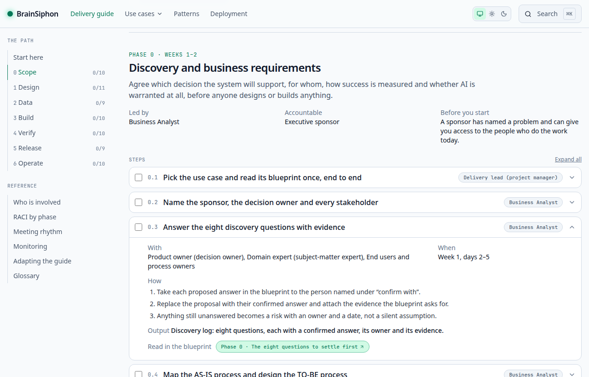
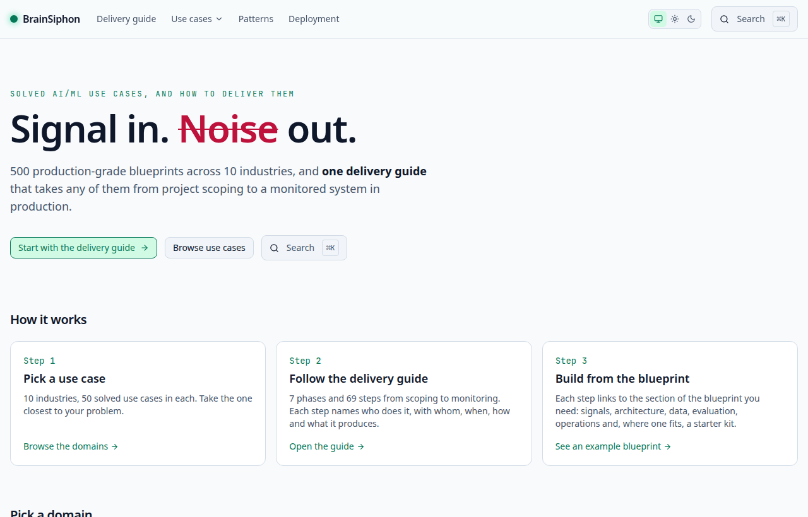
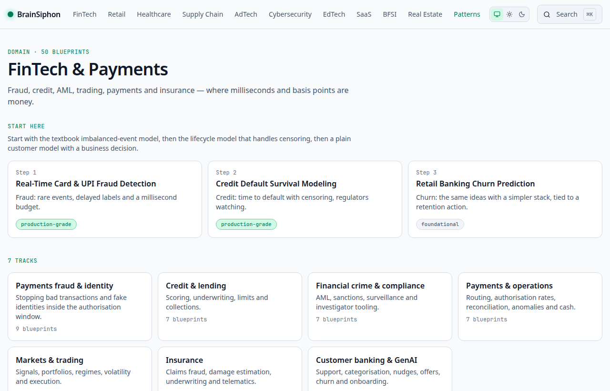
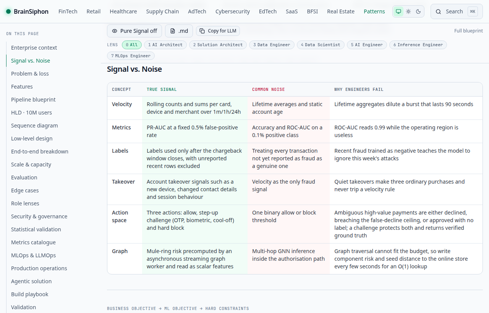
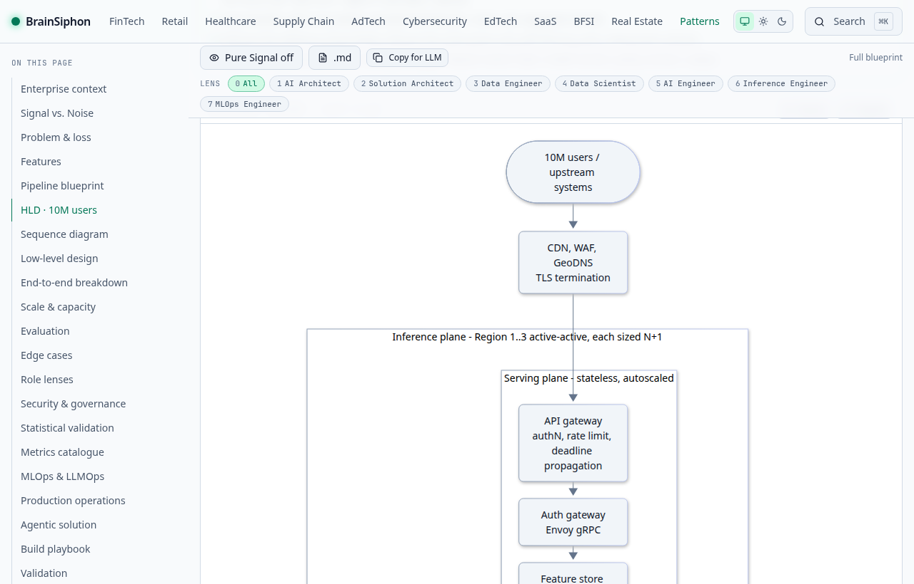
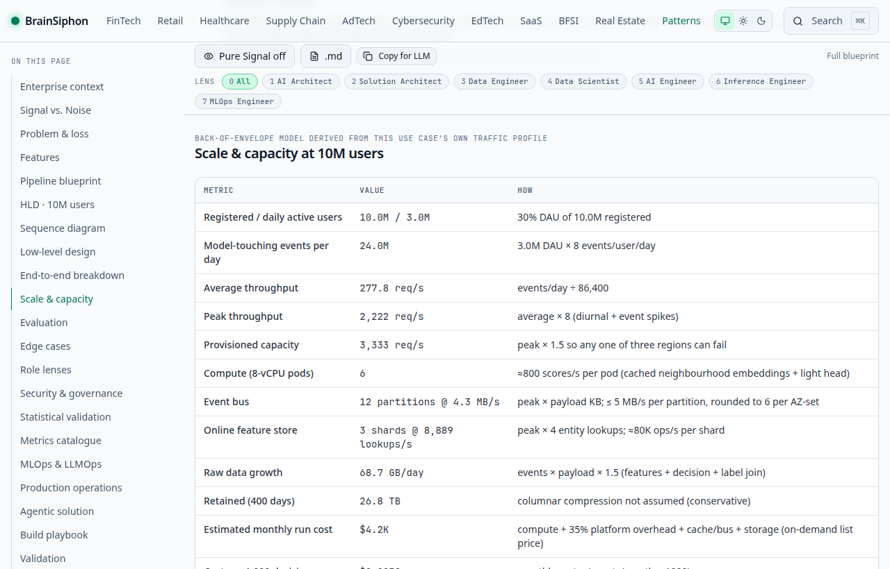
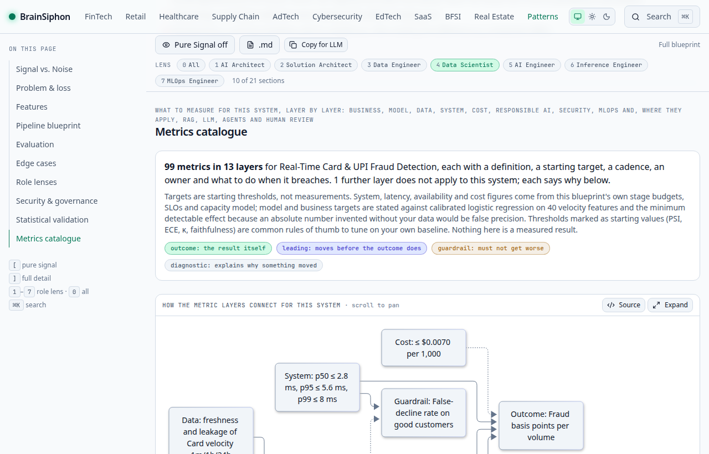

# BrainSiphon

URL: https://sadiqgpasha89.github.io/BrainSiphon/

**What this is, in five lines**

1. BrainSiphon is a static website of **500 enterprise AI/ML system blueprints** across 10 industries (50 each), written for engineers who have to design, build and run them.
2. Every blueprint separates the **signal** that moves the metric from the **noise** that wastes your quarter, then goes from the business problem through the high-level design, sequence diagram, low-level design, MLOps, governance and operations.
3. Every design is sized for **10 million users** with a transparent capacity and cost model, and a live calculator you can re-run with your own traffic.
4. Each page also has a **metrics catalogue** (business, model, data, system, cost, safety, plus RAG, LLM and agent metrics where they apply), the edge cases that break the system, and a **build playbook** with milestones and exit gates.
5. Read it your way: keys `1`–`7` keep only what an AI architect, solution architect, data engineer, data scientist, AI engineer, inference engineer or MLOps engineer needs; `[` is Pure Signal mode, `⌘K` searches, and every page exports as clean Markdown for LLMs.

> Blueprints are generated from a typed spec and have **not** been reviewed by a domain expert; every number is a modelled starting point, not a measurement. Each page says so.

## Delivery guide: from project scoping to deployment and monitoring

A blueprint is the worked answer for one use case. The **delivery guide** is the order to do the work in, and it is the same for
all 500: **7 phases, 69 steps**. Every step names its owner, who takes part, when, how, the output and the blueprint section to
read; every phase ends in a gate with named signers.

- On the site: [`/delivery`](https://sadiqgpasha89.github.io/BrainSiphon/delivery/). Choose a use case and each step links into
  that blueprint; choose a role and only that role's steps remain; tick steps off as you go (kept in the browser, per use case).
  Every blueprint has a "Deliver this use case" button that opens the guide with it selected.
- As one file: [`docs/DELIVERY_GUIDE.md`](docs/DELIVERY_GUIDE.md), also served at `/delivery.md` and listed first in `/llms.txt`.
- It covers the 14 delivery roles and 9 business partners (sponsor, product owner, delivery lead, domain expert, end users, data
  owner, risk and compliance, finance, support), a RACI by phase, the meeting rhythm, the seven monitoring layers after go-live,
  and how the path changes for a solo learner, a small team, and for forecasting, recommender, LLM/RAG/agent, bandit and solver
  use cases.



**Evaluation, guardrails and governance.** These are covered on every blueprint, and the guide and the blueprints now say
where:

- Each blueprint's **Evaluation** section is a full plan: what has to be proven, the offline protocol, release thresholds, LLM
  and agent evaluation where there are agents, the online experiment with its guardrail metrics and stopping rules, what keeps
  evaluating after launch, and the executable checks. It is gathered from the statistical-validation, metrics, agentic and MLOps
  fields the blueprint already has (`src/content/assurance.ts`), so nothing is stated twice in the source.
- Each blueprint's governance section has a **Guardrails** table in six layers (hard constraints, runtime controls, outcome
  guardrails, human oversight, degradation, stop and roll back). A design with no language model or agent says so instead of
  leaving a gap; a test fails if any LLM blueprint lacks runtime controls.
- The guide has an **index** from each concern (evaluation, guardrails, governance, responsible AI, security, privacy,
  monitoring, reliability, cost) to its steps and blueprint sections, and a **framework crosswalk** for the EU AI Act, NIST AI
  RMF, ISO/IEC 42001, the GDPR impact assessment and the OWASP Top 10 for LLM Applications. The crosswalk is a reading map, not
  legal advice. Per-industry obligations stay in each blueprint and are still per domain, not per use case.

The guide has one source, `src/content/delivery.ts`. The page, the markdown and the RACI are all derived from it: edit that file,
run `npm run guide:build`, and commit the regenerated `docs/DELIVERY_GUIDE.md` (a unit test fails if the two disagree). The same
test checks that every role responsibility in `src/lib/roles.ts` is covered by a step, and an end-to-end test checks that every
blueprint section the guide links to exists on blueprints of different kinds. Week numbers in the guide are a 16-week planning
default, not a measurement.

The site navigation follows the same idea: the header has four destinations (Delivery guide, Use cases, Patterns, Deployment),
the home page is "pick a use case, follow the guide, build from the blueprint", and inside a blueprint the 22 sections are grouped
as Understand, Design, Prove, and Ship and run, with the role lens folded behind one button.

## How it works

Screenshots of the live site, using one blueprint (Real-Time Card & UPI Fraud Detection) as the example.

**1. Pick a use case.** The home page is three steps: pick a use case, follow the delivery guide, build from the blueprint. Ten industries, 50 blueprints each.



**2. Start where the site tells you to.** Each domain opens with a three-step "start here" path and 7 to 8 tracks that filter its 50 blueprints.



**3. Learn the signal and the noise.** The matrix names what actually moves the metric, what only looks like it does, and why engineers get it wrong.



**4. See the architecture.** High-level design for 10 million users, then the sequence diagram, low-level design, MLOps and operations.



**5. Check that it fits your scale and budget.** A capacity and cost table built from the use case's own traffic profile, re-runnable in the page.



**6. Read only what your role needs, and know what to measure.** The lens bar (here: Data Scientist, 10 of 21 sections) hides the rest; the metrics catalogue lists what to track, with targets, owners and what to do on a breach.



Zero-noise **enterprise AI architecture and engineering playbook** — **500 use cases, 10 domains × 50**. Every blueprint
teaches the _signal_ that moves the metric, names the _noise_ that wastes your quarter, and takes the solution from the
enterprise context (business, applications, data, security, operating model) through HLD, sequence diagram, LLD, MLOps,
governance and production operations to a capacity/cost model for **10 million users**, with evaluation and edge cases.

> **Which deployment am I looking at?** The GitHub Pages site is a **static export**: it uses the build-time MiniSearch
> index and has no Postgres, Redis, middleware or API routes. The **Docker deployment** (`docker compose up`) runs the full
> stack: Postgres + pgvector hybrid search, Redis cache and rate limiting, health endpoints and telemetry.

## Blueprint 2.0: what every use case now contains

| #   | Section                          | Where it lives                                                  |
| --- | -------------------------------- | --------------------------------------------------------------- |
| 1   | Enterprise solution context      | `enterpriseContext`: business, application, data, technology, security, operating architecture; C4 context and container diagrams; integration matrix; data-quality SLA and a data-contract example; NFR matrix; ADRs; build / buy / integrate |
| 2   | AI solution decision matrix      | `decisionMatrix`: why AI, why not rules, why this paradigm, alternatives, why chosen, what would change it, human oversight, economics |
| 3   | AI/ML problem formulation, data, architecture, HLD, LLD, evaluation | the original sections |
| 4   | Security, governance, responsible AI | `governance`: risk tier (low/medium/high/critical), approval path, data/model/responsible-AI controls with evidence, AI-security threats, obligation → control → evidence |
| 5   | MLOps (and LLMOps where it applies) | `mlops`: nine lifecycle areas each with an artifact and a gate, retraining triggers, champion/challenger, rollback, toolchain |
| 6   | Production operations and SRE    | `operations`: SLIs/SLOs/error budgets, telemetry, incident classes, support model, ten failure scenarios (detection → alert → owner → mitigation → recovery → learning), unit cost |
| 7   | Validation and architecture review | `validation`: provenance (who made each part, what kind of number each figure is, owner, reviewer, sources, assumptions, limitations), five separate validation levels and the feasibility checks |
| 8   | Statistical validation and business experimentation | `experimentation`: causal question and estimand, experimental design by archetype (interleaving, switchback, rolling-origin backtest, shadow then holdout, replay then canary), power arithmetic, label maturity and selection bias, calibration and uncertainty, slices and fairness, causal methods, stopping rules, business-value measurement |
| 9   | Archetype-driven low-level design | `systemDesign.lld`: one of nine solution archetypes picks the API contract, data model, event schema, core algorithm, failure and retry behaviour, security model and test scenarios; always labelled an illustrative scaffold unless a review is recorded |
| 10  | An explicit verdict on agents | `agentic.decision`: why an agent is or is not better than a rules engine, a conventional model, an optimiser, RAG or a deterministic workflow, with cost, risk, fallback and when to revisit |
| 11  | Metrics catalogue                | `metrics`: about 65 to 110 metrics per use case in up to 14 layers, each with a definition, a starting target, a cadence, an owner and what to do on a breach. Ten layers apply to every system (business, adoption and trust, model, data and features, system and reliability, cost and sustainability, responsible AI, security and compliance, MLOps and delivery, experimentation health); four appear only where the system has the component (RAG, LLM serving, agents, human review) and otherwise say why they do not apply. Also a metric tree, a monitor for each of the use case's own edge cases, and how each headline metric gets gamed (`src/content/metrics.ts`) |
| 12  | Starter-kit compatibility, completion state and artifact labels | `playbook.compatibility`, `playbook.completion`, `systemDesign.lld.artifacts`: a starter kit is shipped only when it implements the same problem (exact, adaptable with named modifications, or none: guidance only), how far its executable artifacts get an engineer on a four-step ladder (prototype, evaluation, shadow, production), and a label on every code block saying what kind of artifact it is |

The enterprise layer is generated deterministically from each use case's own fields plus per-domain enterprise facts
(`src/content/enterprise.ts`, `src/content/enterprise-domains.ts`). It is **not** expert-reviewed (see below).

The metrics catalogue is built from each use case's own fields (its offline and online metrics, signals and their leakage risks, pipeline stages and latency budgets, edge cases, SLOs, capacity model, regulatory obligations, agents and tools), not from a fixed list. System, latency and cost targets repeat the blueprint's own budgets; model and business targets are stated against the baseline and the minimum detectable effect, and thresholds such as PSI, ECE, kappa and faithfulness are labelled starting values. They are proposed targets, not measurements.

### Validation levels (they are not the same thing)

Every blueprint shows five statuses **side by side**. There is no combined "verified" badge, because the five are different kinds of
evidence and a reader needs to see exactly which have been earned:

| Status                     | Shown as                              | Meaning                                                              | Evidence comes from                            |
| -------------------------- | ------------------------------------- | -------------------------------------------------------------------- | ---------------------------------------------- |
| Schema validated           | Passed                                | Required sections and types passed the strict Zod schema             | the build (a failure stops it)                 |
| Architecture feasibility   | Passed / Passed (n warnings) / Failed | Diagrams parse, equations compile, the numbers agree with each other | `npm run validate:content`                     |
| Synthetic starter tested   | Passed / Failed / Not run             | The starter kit for this blueprint ran end to end on synthetic data  | `npm run test:playbooks` report for this content |
| Domain expert reviewed     | Not reviewed (until a review is recorded) | A domain specialist reviewed the technical content               | `content/reviews.json` (empty by default)      |
| Production evidence        | Not available                         | Evidence from a real deployment or production dataset                | not claimed for any blueprint                  |

"Passed" for the starter is shown only when a kit report exists for **exactly this content**; a build that did not run the kits says
"Not run". To record an expert review, add `{"<domain>/<slug>": {"reviewer": "...", "date": "YYYY-MM-DD", "scope": "..."}}` to
`content/reviews.json`.

### Release provenance and the deploy gate

Every build writes `release.json` (served at `<site>/release.json`, shown in the footer and in each blueprint's Validation section,
and summarised in the header of each blueprint's `.md` twin):

| Field                                     | Meaning                                                                                           |
| ----------------------------------------- | ------------------------------------------------------------------------------------------------- |
| `sourceCommit` / `sourceDirty`            | The Git commit SHA the content was built from, and whether the tree had uncommitted changes       |
| `contentVersion` / `contentDigest`        | `<package version>+<12 hex>` and the sha256 over every content input (`content/`, `src/content/`, `src/schemas/`) |
| `validatedAt`                             | When `validate:content` last passed for exactly this content (null if no matching report)         |
| `deployedAt`                              | When the deployment artefact was built (null for a build that is not a deployment)                |
| `checks.schema` / `checks.feasibility`    | Status of the schema and architecture-feasibility checks across all 500 blueprints                |
| `checks.executable`                       | Starter-kit results (one entry per kit) and when they ran                                         |
| `checks.domainExpert` / `checks.productionEvidence` | How many blueprints have a recorded expert review / production evidence (both 0 today)  |

A report is only used when its content digest equals the build's, so a validation or kit run from earlier content can never vouch for
later content. The reports are `.release/validation.json` (written by `validate:content` only after every gate passes, and removed at
the start of each run) and `.release/kit-results.json` (written by a full `test:playbooks` run).

**The deployment fails unless the published content corresponds to the validated release.** In CI, `deploy-pages`:

1. downloads the `kit-results` artefact that the `starter-kits` job produced for this commit;
2. runs `build:static` with `BS_RELEASE_STRICT=1`, which re-runs `validate:content`, then runs `release:check` (same commit, same content
   digest, clean tree, every starter kit present and passed, no feasibility failure) and stops before building if anything disagrees;
3. has `verify:static` check that `out/release.json` matches the checkout and that every page and `.md` twin carries the release and all
   five statuses and none makes a combined "verified" claim;
4. after publishing, the `verify-live` job fetches the live `release.json` (retrying while the CDN catches up) and fails if the served
   commit or content digest differs from the commit that was just validated.

```bash
npm run release:check                     # does the current build correspond to a validated release? (add BS_RELEASE_STRICT=1 for the deployment rules)
SITE=https://<owner>.github.io/<repo>/ EXPECTED_SHA=<sha> npm run verify:live
docker build --build-arg GIT_SHA=$(git rev-parse HEAD) .   # the image has no .git; this names the commit in release.json
```

### Architecture Feasibility Validator

A blueprint does not pass because every section exists; its numbers must agree (`src/content/feasibility.ts`, run at generation
and again in `validate:content`). Checks: the synchronous stage budgets plus edge plus a network/serialisation reserve must sum
to the p99 exactly (an earlier version summed to 8.6 ms against 8 ms); hand-written stage budgets must equal the HLD; a stated
p99 must not be tighter than the envelope; demand must fit provisioned capacity; availability vs redundancy; storage vs a stated
retention; cost sanity; RTO/RPO vs the replication strategy; and model memory vs GPU memory. A `fail` breaks the build, a `warn` is shown on the page.


## How to find your way

- **Start here and tracks.** Each domain page opens with a three-step "Start here" path, then 7–8 tracks (for example
  fintech: payments fraud, credit and lending, financial crime, markets, insurance). A track filters the catalog.
  Both live in `content/tracks.json`; the build fails unless the tracks of a domain cover every use case exactly once.
- **Patterns.** `/patterns` lists the 11 reference patterns (the same eleven as the starter kits). Each hub shows what the
  pattern teaches, how to run its kit and every blueprint, in every domain, that is an instance of it.
- **Problem, solution and architecture, per use case.** Each blueprint has its own problem statement, solution approach and a
  stage-by-stage account of why each part of its architecture exists, all assembled from that use case's own signals,
  constraints, edge cases and metrics. The end-to-end breakdown is gated so that under 3% of its steps may be identical
  between use cases (it was 47% before).
- **Phase 0: discovery and business requirements (compulsory).** Every blueprint opens with a `discovery` section that no
  blueprint can omit (the schema has no optional form and `validate:content` re-checks it). It answers the eight questions a
  Business Analyst settles before any design: who the actual user is, who owns the business decision, what the existing process is,
  which application consumes the output, what happens when the output is wrong, who approves changes to business policy, the
  baseline business performance and how financial or operational ROI is measured. It also carries the AS-IS and TO-BE process,
  stakeholders, user journeys, functional requirements with given/when/then acceptance criteria, a RACI, a business case with an ROI
  formula, and a Phase 0 exit gate. All of it is generated from the use case and its domain (`src/content/discovery.ts`) and is
  labelled `to-confirm`: these are starting positions for a discovery workshop, never findings about a real organisation, so every
  exit-gate item is open until a client confirms it.
- **Role lenses (fourteen roles, combinable).** Business Analyst, Solution Architect, AI Architect, Data Analyst, Data Engineer, Data
  Scientist, ML Engineer, AI Engineer, MLOps Engineer, Inference Engineer, Platform Engineer, SRE / DevOps Engineer, Security Engineer
  and QA / Test Engineer. They are not fourteen navigation entries: in a blueprint, press a role's key (`1`–`9`, then `a`–`e`) or click
  its chip in the Lens bar to add or remove it, and `0` clears. Pick several and the page keeps the union of their sections and shows a
  **combined view**: every phase of one common engineering lifecycle (Phase 0 discovery, architecture, data, model and application
  build, platform/security/verification, release, operate) with what each selected role does in it, the handoffs between them, and the
  handoffs they must receive from or give to roles they did not pick. Data Engineer + MLOps Engineer, for example, gives the data
  pipeline, the training pipeline, the deployment dependencies for the platform team and the operational handoff to SRE. The role
  model is in `src/lib/roles.ts`. Each blueprint ends with a per-role checklist of production gaps (`roleLenses`, at least three items
  per role), generated from the use case's own stages, features and compute class (`src/content/extras.ts`).
- **Regions and state.** The HLD no longer says "three active-active regions" for everything. `systemDesign.topology` splits the
  stateless inference plane (active-active) from the state plane: pinned by jurisdiction with a synchronous in-country standby for
  fintech, BFSI and healthcare; tenant cells, quotas and BYOK for SaaS, cybersecurity and real estate.
- **Primitives.** Mechanisms that repeat across blueprints (point-in-time joins, PID budget pacer, adaptive load shedding, outbox + CDC,
  plan-preview-commit, ...) are written once in `src/content/primitives.ts`, shown at `/patterns/primitives/<id>`, and linked from every
  blueprint that uses them. `validate:content` fails on a link to an unknown primitive.
- **Live sizing calculator with workload profiles.** The capacity table is followed by a calculator that re-runs the same model
  (`src/content/scale.ts`) in the browser. Choose the unit the workload is really sized in (`src/content/workload-profiles.ts`):
  user/session, transaction (TPS), asset/equipment, document/image/video, LLM/agent (requests × steps × tokens), batch (rows × runs),
  **forecasting** (series × runs × horizon × quantiles), **streaming** (events/s, burst ratio, resident state) or **recommendation**
  (requests/s × candidates scored). Each industry opens in its natural profile and forecasting use cases open in the forecast profile;
  at the defaults every profile reproduces the table (tested). A batch use case that states its own volume ("5M series nightly") is
  sized from it rather than from 10 million app users. The table and calculator also show an all-in monthly cost (retraining,
  observability, data transfer, backup/DR, human review), a low / expected / high range, P50 / P95 / P99 load scenarios and a cost per
  business outcome (per forecast series-run, per document, per decision...). Retraining, observability and transfer are modelled shares, not measurements.
- **Pattern hierarchy.** `/patterns` now shows three levels: L1 AI/ML archetypes (the 11 kits), L2 enterprise architecture patterns
  (`src/content/architecture-patterns.ts`: online inference, event-driven AI, batch scoring, human-in-the-loop, multi-tenant, LLM gateway,
  jurisdiction-pinned state, strangler coexistence) and L3 engineering primitives (the mechanisms in `src/content/primitives.ts`).
- **Agentic solution, or a reasoned "no agent".** Every blueprint first answers "why is an agent better than a rules engine, a
  conventional model, an optimiser, RAG or a deterministic workflow?" with a verdict per option. Where agents help (language products, or
  systems with a review queue to feed) it then gives the agents, typed tools, an autonomy ladder with promotion gates, guardrails and
  evaluation. Where they do not (batch or low-latency pipelines with no human queue, closed-loop bidding policies, solver-driven planning),
  the fit is `not-recommended` or `not-applicable`, no agents are defined, and the page shows the recommended non-agentic architecture and
  what would change the answer. The rule lives in `agentVerdict` in `src/content/agentic-gen.ts`.
- **Deployment modes.** `/deployment` compares the static GitHub Pages site, the Docker stack and a cloud-hosted production deployment, and
  lists what the static site leaves out.

## Review follow-ups

Done in this branch (from an architecture and engineering review): MLOps lens, validation levels and provenance, workload-aware
capacity with cost scenarios, archetype-driven LLD, explicit no-agent verdicts, statistical validation and experimentation, and the
deployment-modes page. Still open, in the order we would take them:

- Represent pipelines as a DAG (fan-out, fan-in, retries, several consumers) instead of a linear chain with async sidecars.
- Make residency, tenancy and active-active choices an explicit per-blueprint input rather than an industry default.
- A structured security / privacy profile per use case (classification, residency, retention, threat scenarios) beyond the shared governance controls.
- Graph-analytics and multi-tenant SaaS workload profiles for the capacity calculator.
- An Enterprise AI and data platform category (lakehouse, feature platform, ML platform, LLM gateway, RAG platform, agent control plane...) and additional industries.
- Workshop flow, decision comparison and a downloadable architecture package (diagrams, ADRs, contracts, schemas, test plans).
- Executable starter kits for the most important implementation patterns, and recorded expert reviews in `content/reviews.json`.

## Quick start

```bash
npm ci
npm run dev                       # content:build + next dev   → http://localhost:3000
npm run guide:build               # regenerate docs/DELIVERY_GUIDE.md after editing src/content/delivery.ts
npm run validate:content          # strict gate (schema, ≥50/domain, KaTeX, Mermaid, slug history, staleness)
npm test                          # unit/integration tests
npm run build && npm run test:e2e # production build + Playwright smoke tests
docker compose up --build         # app + pgvector + redis        → http://localhost:3200
npm run build:static              # CDN / GitHub Pages export → ./out (also verifies llms.txt, every .md route, base-path links and release.json)
npm run test:playbooks            # run every starter kit; writes .release/kit-results.json
npm run release:check             # does this build correspond to a validated release?
npm run verify:static             # re-run that verification on an existing ./out (set NEXT_PUBLIC_BASE_PATH / NEXT_PUBLIC_SITE_URL as in CI)
```

## How 500 deep blueprints stay consistent

Authoring is a compact, strongly-typed text format in `content/usecases/<domain>.N.uc` (see `src/content/parse.ts`).
One use case is ~25 lines: objective, loss (LaTeX), constraints, signal-vs-noise rows, high-signal features with leakage risk,
noisy features, baseline, production model, **pipeline stages**, edge cases, metrics, and a traffic profile (`a` events/user/day, `k` KB/event).

A typed generator (`src/content/expand.ts`, `design.ts`, `scale.ts`) turns that spec into the full blueprint and validates it
against the strict Zod schema (`src/schemas/usecase.schema.ts`) — **a missing section fails the build**:

| Output                                               | Derived from                                                                                 |
| ---------------------------------------------------- | -------------------------------------------------------------------------------------------- |
| Pipeline + HLD + sequence + class diagrams (Mermaid) | the use case's own stages; latency budgets split by stage kind                               |
| API contract, DDL, events, hot-path code, runtime config, failure/security/test tables | the use case's solution archetype (`src/content/archetype-lld.ts`) filled with its own features, loss, stages and guardrail metrics; a scaffold, not production code |
| Degradation ladder                                   | serving mode (online / interactive / batch)                                                  |
| 10-phase end-to-end breakdown                        | every authored field (objective, labels, features, models, metrics, edge cases)              |
| Capacity & cost table                                | `a`, `k`, compute class (CPU scorer, GPU ranker, vision, encoder, LLM tokens/s, Spark batch), or the volume the use case states; defaults to 10M users otherwise |

> The capacity table is a transparent back-of-envelope model (assumptions are printed on every page), **not** a quote.

## Problem statement, solution approach and end-to-end breakdown

Every use case has a problem statement, a solution approach, a stage-by-stage architecture rationale and a ten-phase
end-to-end breakdown. The 8 pilot use cases carry **hand-written** versions in `content/narratives/<domain>/<key>.yaml`
(the page marks them "hand-written"); the other 492 are **generated** from each use case's own objective, constraints,
signals, traps, metrics and pipeline stages, and are marked "generated". An authored file replaces the generated text for
that use case; its rationale table must list exactly the pipeline's stages in order, which the build checks.

## Build playbooks (all 500: 8 hand-written, 492 generated)

A blueprint explains *what a good system looks like*. A **Build playbook** is what an intermediate engineer needs to
*build it*: the domain knowledge and terminology to learn first, where the data comes from, ordered milestones with numeric
exit gates, a starter kit where a compatible one exists, a worked example, an executable test plan, decisions and pitfalls,
and a 30-day launch checklist.

**Two tiers, labelled on every page.**

- **Hand-written (8 pilots, one in each of the original eight domains).** Each has its own starter kit and numbers measured from its runs:
  card fraud, sepsis early warning, CTR prediction, demand sensing, session recommendation, knowledge tracing, SOC investigation
  agent and a developer docs assistant.
- **Generated (the other 492).** Assembled from the use case's *own* authored fields (objective, constraints, signals,
  noise, baseline and production model, pipeline, edge cases, metrics and traps), shared domain and method knowledge
  (`content/domain-knowledge`), a curated and link-checked dataset registry (`content/dataset-registry.json`) and, **only where
  one is compatible**, one of **11 reference starter kits** (`content/kits`: tabular, forecast, anomaly, recommender, graph, nlp,
  cv, bandit, optimize, llm-rag, llm-agent), each run on synthetic data and tested in CI. Generated playbooks are specific to the
  use case where the blueprint is, and generic where it is not; they have not been reviewed by a domain expert, and the kit
  numbers are the reference kit's, not the use case's.

### Starter-kit compatibility (a build gate, not a label)

Sharing a broad paradigm is not enough to share a starter. Survival modelling, uplift, regression and event classification are all
"tabular", and none can reuse another's labels, validation, metrics or model. Every use case is therefore classified into a **problem
type** (`src/lib/problem-types.ts`: 28 types, decided by `classifyProblem` in `src/content/kit-compat.ts` from its own metrics, title
and pipeline, with explicit per-use-case overrides and reasons in `content/kit-compatibility.json`) and compared, dimension by
dimension, with the **contract of every reference kit** (`content/kit-contracts.json`):

| Dimension | Example: credit default survival | Example: card fraud |
| --- | --- | --- |
| Prediction problem | time to event | event classification |
| Label and target | right-censored | delayed binary label |
| Validation method | cohort split that keeps censoring | chronological, entity-safe split |
| Evaluation metrics | time-dependent AUC, calibration | PR-AUC, recall at a fixed false-positive rate |
| Data shape and timing | loan lifecycles with censoring | transaction events |
| Model family and baseline | Cox or discrete-time hazard | logistic regression then boosted trees |
| Serving mode and latency | batch | online, a few milliseconds |
| Integrations and operations | lakehouse, review sign-off | feature store, case queue |

The outcome is one of three, shown on every blueprint (header chip, "Fit with the starter kit" table, pattern hubs, catalog badge, `.md`):

- **Exact match.** The kit implements the same fundamental problem. It runs on synthetic data; serving and rollout are still yours.
- **Adaptable match.** The kit has reusable parts but implements a neighbouring problem (for example next-item recommendation for
  personalised search ranking, or a read-only agent for a copilot that performs authorised actions). The page lists the parts that carry
  over and the **modifications required first**; no milestone is labelled "runs in the starter".
- **No match.** *No compatible executable starter kit exists. This playbook provides architecture and implementation guidance only.*
  No starter code, no synthetic data and no kit numbers are shipped, the worked example is blueprint-only, and the page names the
  closest kit for background reading only, with the reason it is not a starter.

Today, of the 500 blueprints: 8 hand-written exact starters, about 100 exact generated matches, about 320 adaptable and 70 with no
compatible kit (`npm run validate:content` prints the current counts). The generator **never picks a kit on its own**: it receives the
verdict, and the schema rejects a playbook that ships a kit its verdict does not allow. `validate:content` (`src/content/kit-gate.ts`)
fails the build if a kit is shipped for a problem its contract does not claim, if an adjacent problem is called an exact match, if the
record does not show all eleven kits as compared, if a "none" playbook ships any kit material, if a plan uses the vocabulary of a
different problem (a credit-survival playbook teaching chargebacks and mule accounts), or if a regression case from review changes
(`KNOWN_CASES`: credit survival, personalised search, the in-app copilot, the fraud pilot and others).

### How far the executable artifacts get you (completion state)

Every playbook states which of four states its **actual executable artifacts** reach, with the evidence and what is still needed:

| State | Meaning |
| --- | --- |
| Prototype-ready | Synthetic data and an initial algorithm run end to end |
| Evaluation-ready | Reproducible experiments, baselines and validation that fail when the method is wrong |
| Shadow-ready | Production-connected scoring that sees live traffic but changes no business decision |
| Production-ready | Approved live deployment with monitored operations, rollback and a named support owner |

The 8 hand-written pilots reach **evaluation-ready** (M1 to M4 are running, tested code; M5 and M6 are your platform). An exact generated
match reaches prototype-ready, and an adaptable one only after its modifications. A "no match" playbook reaches **guidance only**. **No
use case reaches shadow-ready or production-ready**: that is the engineer's platform work, and the schema enforces that M5 and M6 are
never labelled as supplied by a starter. Each milestone also says how it is supplied: *runs in the starter*, *adapt the starter*,
*guidance only* or *your platform*.

### Artifact labels

Every code block, schema, contract, config and starter file carries one of four labels, defined on the page: **production code** (none
exists on this site), **executable reference code** (runs and is tested in CI on synthetic data), **pseudocode** (code-shaped, never
compiled, run or tested: the low-level design's hot path) and **architectural illustration** (schemas, contracts, configs and diagrams
whose names and values are examples). The build fails if anything is labelled production code.

```bash
npm run test:playbooks            # run every kit and pilot starter's pytest suite (needs Python 3.11+ and content/playbooks/requirements.txt)
npm run check:links               # verify every dataset URL (network)
```

Hand-written playbooks live in `content/playbooks/<domain>/<use-case>/` and `content/playbooks/README.md` is the authoring
template; `npm run validate:content` enforces its depth rules for them. Every loss formula also has a per-symbol legend
(`content/loss-lexicon.json` for shared symbols, `content/loss-variables.json` for use-case-specific ones); the build fails if any
symbol in any formula is unexplained.

Caveats worth knowing: the LLM-based kits (SOC copilot, docs assistant, and the `llm-agent` and `llm-rag` reference kits) use a
deterministic stand-in for the model, so the harness, guardrails and evaluation are real and testable offline; every kit's
numbers come from *synthetic* data (far easier than production); the dataset links are for the real-data run.

## Architecture

- **Next.js 15 App Router**, RSC + `generateStaticParams` (556 statically generated pages in the static export: the 500 blueprints, 10 domain hubs, 11 pattern hubs, 27 primitive pages and a handful of site pages; every blueprint also has a static `.md` twin) + ISR; Tailwind; Radix; `cmdk`; KaTeX; Shiki (server-side); Mermaid (lazy, client).
- **Search** (`/api/search`): Redis cache → Postgres hybrid (full-text `ts_rank_cd` + `pgvector` cosine, fused by **Reciprocal Rank Fusion**) behind an 800 ms **circuit breaker** → build-time **MiniSearch** fallback. Embeddings are deterministic feature-hashing vectors (`src/lib/search/embed.ts`), the single swap-in point for a learned encoder.
- **Rate limiting**: Redis sliding-window (atomic Lua) with in-memory LRU fallback. **Validation**: Zod on every query parameter.
- **Ops**: OpenTelemetry (`@vercel/otel`), Pino JSON logs with `x-request-id` correlation and redaction, `/api/health/liveness`, `/api/health/readiness` (2 s dependency timeouts, 200/503), strict CSP + HSTS + nosniff + Referrer/Permissions-Policy.
- **SEO / agents**: `sitemap.xml`, `robots.txt`, dynamic OG images (`/api/og?slug=`), `/llms.txt`, and a clean `.md` for every blueprint (append `.md` to the URL).
- **Slug evolution**: `content/slug-history.json` → 308 redirects in middleware (client-side equivalent in static export).
- **Keyboard**: `⌘/Ctrl+K` search, `/` search, `[` Pure Signal Mode, `]` full detail, `1`–`9` and `a`–`e` add or remove a role lens (combinable), `0` all roles.

## Deviations from the original spec (deliberate)

- Content is authored in a compact `.uc` DSL rather than MDX: 500 × ~25 lines is reviewable and diffable, and every file is still validated at build time.
- Search embeddings are feature-hashing vectors, not a neural model, so the project runs offline with no API keys.
- The GitHub Pages deployment is a static export (no Postgres/Redis/middleware); search uses the static index there. The Docker/compose deployment runs the full stack.
