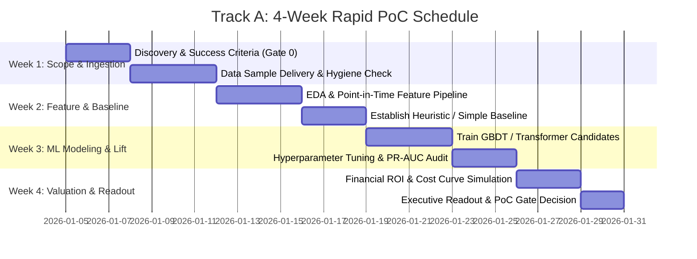
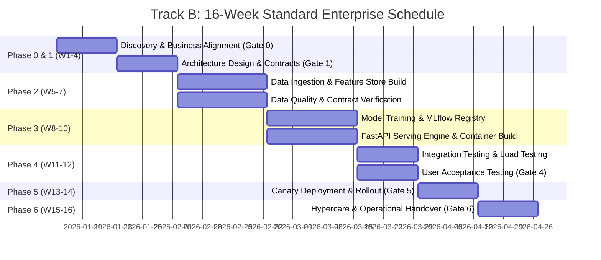
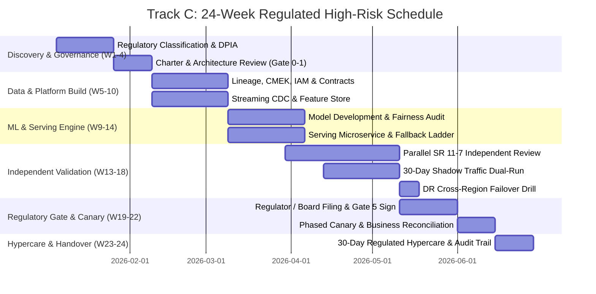

# Delivery Project Plans: Standard Schedules & WBS

BrainSiphon provides three distinct project plan archetypes tailored to organization maturity, risk profile, and regulatory requirements:
1. **Track A: 4-Week Rapid Proof of Concept (PoC)** — Rapid feasibility, baseline model development, and offline evaluation on historical customer data.
2. **Track B: 16-Week Standard Enterprise Production** — Complete end-to-end delivery: streaming data pipelines, feature store, serving microservice, canary deployment, and hypercare.
3. **Track C: 24-Week Regulated High-Risk Production Deployment** — Complete banking / healthcare grade lifecycle: independent model validation (SR 11-7 / EU AI Act), failover drills, penetration testing, dual-run shadow evaluation, and regulatory sign-offs.

---

## Track A: 4-Week Rapid Proof of Concept (PoC)

### Overview
- **Goal:** Prove technical and economic feasibility. Answer: *Can machine learning deliver a statistically significant lift over existing heuristic baselines on customer data?*
- **Team:** 1 Delivery Lead (0.2 FTE), 1 Solution Architect (0.5 FTE), 1 Data Scientist (1.0 FTE), 1 Data Engineer (0.5 FTE).
- **Environment:** Isolated development sandbox; sanitized/synthetic historical dataset.

### Work Breakdown Structure (WBS)
- **W1 (Days 1–5): Scope & Data Hygiene**
  - Finalize BRD and success criteria (Target: $> 15\%$ lift in PR-AUC or Recall @ 0.5% FPR over heuristic).
  - Provision isolated sandbox with S3/GCS bucket and compute cluster.
  - Ingest frozen historical sample (e.g. 6 months historical data with 90-day label maturity).
  - Execute automated data quality check (`great_expectations` / Pandera).
- **W2 (Days 6–10): Baseline & Features**
  - Implement point-in-time correct train/test split (Walk-Forward or time-stratified).
  - Code baseline model (Logistic Regression / current heuristic rules).
  - Engineer primary domain features (velocity, aggregation, interaction terms).
- **W3 (Days 11–15): Candidate Modeling**
  - Train LightGBM / XGBoost / Foundation Model candidate.
  - Evaluate PR-AUC, ROC-AUC, Precision, Recall, and Brier Score.
  - Compute TreeSHAP feature importances and inspect top 20 drivers.
- **W4 (Days 16–20): Business Impact & Readout**
  - Construct financial cost curve ($C_{FP}$ vs $C_{FN}$) to recommend optimal operating threshold.
  - Compile Executive Readout slide deck and PoC Evaluation Summary.
  - Gate Decision: Proceed to Track B/C production build, iterate, or terminate.

---

## Track B: 16-Week Standard Enterprise Production

### Overview
- **Goal:** Full enterprise delivery with real-time serving, automated pipelines, monitoring, and production deployment.
- **Team:** 1 Delivery Lead (0.5 FTE), 1 Solution Architect (0.5 FTE), 1 Data Engineer (1.0 FTE), 1 ML Engineer (1.0 FTE), 1 Platform/SRE Engineer (0.5 FTE), 1 Full-Stack/Integration Engineer (0.5 FTE), 1 FDE (0.5 FTE).

### Detailed Milestone Checklist
- **Phase 0: Scope & Alignment (Weeks 1–2)**
  - Deliverables: BRD (`BS-TMPL-SCOPE-02`), KPI Baseline (`BS-TMPL-SCOPE-06`), Discovery Charter (`BS-TMPL-SCOPE-10`).
  - Milestone: Gate 0 formal sign-off.
- **Phase 1: Architecture & Design (Weeks 3–4)**
  - Deliverables: C4 System Design (`BS-TMPL-DESIGN-01`), OpenAPI 3.1 & AsyncAPI Specs, STRIDE Threat Model (`BS-TMPL-DESIGN-08`), ADRs.
  - Milestone: Gate 1 Architecture Review Board approval.
- **Phase 2: Data Engineering & Contracts (Weeks 5–7)**
  - Deliverables: STTM specification (`BS-TMPL-DATA-01`), streaming CDC pipeline (Kafka/Debezium), online feature store (Redis/Feast), automated quality suite.
  - Milestone: Gate 2 Data pipeline certified on live staging feeds.
- **Phase 3: Core ML & Serving Build (Weeks 8–10)**
  - Deliverables: Production model training pipeline, MLflow registry promotion, FastAPI serving microservice with $< 15\text{ ms}$ P99 latency, circuit breaker and fallback ladder.
  - Milestone: Gate 3 Build complete; artifacts signed in registry.
- **Phase 4: Quality & Verification (Weeks 11–12)**
  - Deliverables: Multi-tier test suite execution (`BS-TMPL-VRFY-01`), $2\times$ peak load test, security penetration test clean sheet, UAT sign-off (`BS-TMPL-VRFY-02`).
  - Milestone: Gate 4 Verification passed.
- **Phase 5: Release & Rollout (Weeks 13–14)**
  - Deliverables: Pre-flight smoke test, Helm/Terraform deployment, Canary release (1% -> 10% -> 50% -> 100%), verified rollback plan (`BS-REL-ROL-01`).
  - Milestone: Gate 5 Go-Live achieved.
- **Phase 6: Operate & Hypercare (Weeks 15–16)**
  - Deliverables: 14-day hypercare completion, SRE operational runbook active (`BS-SRE-RBK-01`), primary on-call rotation transfer.
  - Milestone: Gate 6 Operational handover completed.

---

## Track C: 24-Week Regulated High-Risk Production Deployment

### Overview
- **Goal:** Production deployment under stringent supervisory frameworks (Federal Reserve SR 11-7, OCC 2011-12, OSFI E-23, EU AI Act High-Risk System, HIPAA, PCI-DSS).
- **Key Additions:** Independent 3rd-party Model Validation, 30-day passive shadow run, full Disaster Recovery cross-region failover drill, external red team penetration testing, and regulatory filing.
- **Team:** 1 Delivery Lead (1.0 FTE), 1 Enterprise Architect (0.5 FTE), 1 Lead FDE (1.0 FTE), 2 Data Engineers (2.0 FTE), 2 ML Engineers (2.0 FTE), 1 SRE / DevSecOps (1.0 FTE), 1 Independent Model Risk Officer (External/Parallel), 1 Compliance Lead (0.5 FTE).

### Regulated Governance Safeguards
1. **Model Governance & SR 11-7 Compliance:**
   - Independent validation team conducts exhaustive sensitivity analysis, stress testing under extreme economic conditions, and algorithmic fairness audits.
   - Formal Model Risk Management (MRM) committee sign-off required prior to production authorization.
2. **30-Day Shadow Dual-Run:**
   - The candidate model runs alongside the legacy production system for 30 consecutive days on 100% of live traffic in shadow mode.
   - Outputs are logged and compared daily; zero live transactions are impacted until statistical equivalence and superior performance are mathematically demonstrated.
3. **Multi-Region Disaster Recovery (DR) Drill:**
   - Live failover rehearsal from primary region (e.g. `us-east-1` / `europe-west1`) to secondary region (e.g. `us-west-2` / `europe-west4`).
   - Strict RTO $< 60\text{ seconds}$ and RPO $= 0$ verified with automated database replication and DNS rerouting.
4. **Permanent Audit Trail & Data Lineage:**
   - Complete data provenance captured from raw source to inference decision.
   - Immutably stored in WORM (Write Once Read Many) compliant object storage for 7-year regulatory retention.

