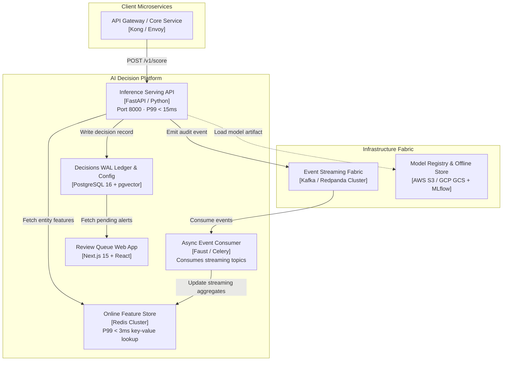
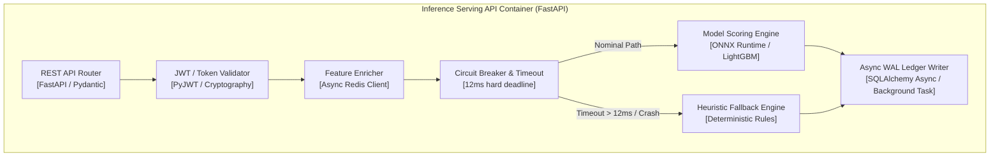
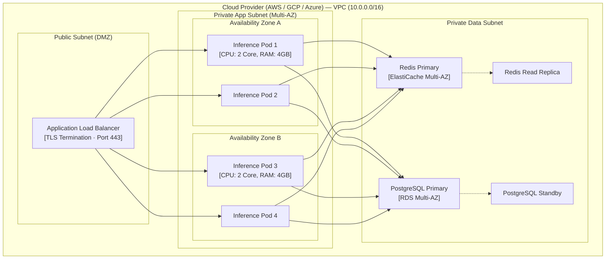

# Standard C4 Architecture Model Suite (System Design Deliverable)

**Document Code:** `BS-TMPL-DESIGN-01`  
**Phase:** Phase 1 — Architecture & Design (Step 1.1)  

---

## 1. C4 Level 1: System Context Diagram
Shows the system in scope, its external human users, and external system dependencies.

```mermaid
flowchart TD
  subgraph Enterprise Boundaries
    User["End Customer / User<br>[Person]"]
    Analyst["Operations Analyst<br>[Person]"]
    
    subgraph BrainSiphon Solution Boundary
      AISystem["AI Decisioning Platform<br>[Software System]<br>Evaluates events in real-time, serves scores, and routes high-risk cases"]
    end
    
    CoreApp["Core Business Application<br>[Software System]<br>System of record, payment core, or ERP"]
    AuthServer["Enterprise Identity Provider<br>[Software System]<br>OAuth2 / OIDC SSO"]
    Warehouse["Corporate Data Lakehouse<br>[Software System]<br>Snowflake / Databricks / Iceberg"]
  end
  
  User -->|Submits action| CoreApp
  CoreApp -->|Invokes scoring API (sub-15ms)| AISystem
  AISystem -->|Returns score & disposition| CoreApp
  AISystem -->|Routes ambiguous cases| Analyst
  Analyst -->|Confirms / Overrides| AISystem
  AISystem -.->|Syncs raw events & decisions| Warehouse
  AISystem -.->|Validates tokens| AuthServer
```

---

## 2. C4 Level 2: Container Diagram
Shows the high-level technical building blocks (containers, web apps, databases, queues).



---

## 3. C4 Level 3: Component Diagram (Inside Inference Serving API)
Shows the internal software components, interfaces, and degradation ladders.



---

## 4. C4 Level 4: Deployment Topology Diagram
Shows the physical and cloud infrastructure mapping (Kubernetes nodes, multi-AZ, security boundaries).



