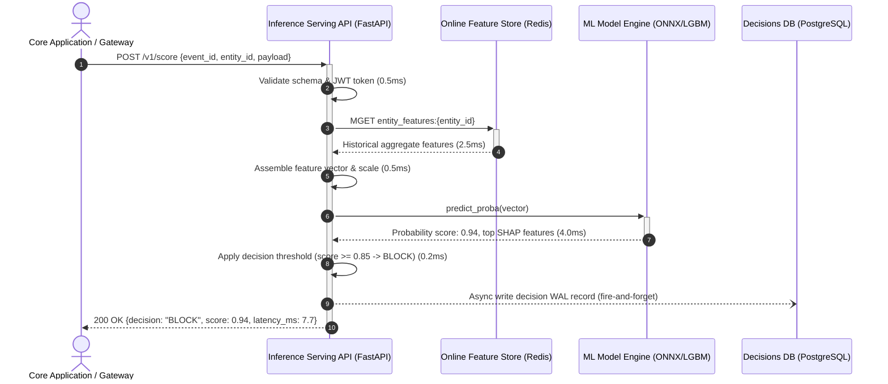
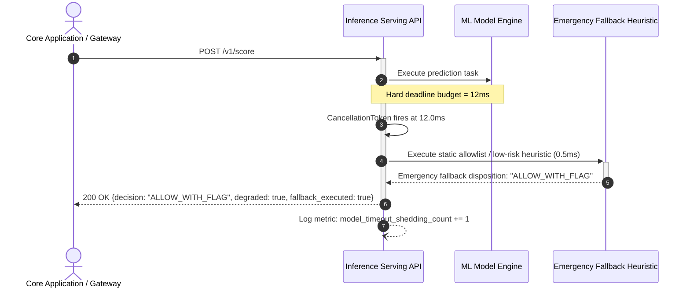
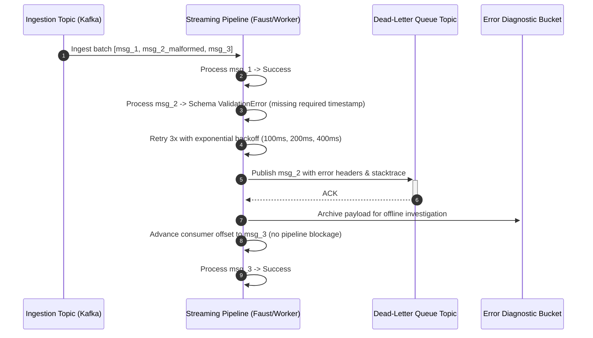

# Nominal & Failure Sequence Diagrams (Resilience Architecture)

**Document Code:** `BS-TMPL-DESIGN-02`  
**Phase:** Phase 1 — Architecture & Design (Step 1.2)  

---

## 1. Nominal Success Flow (End-to-End sub-15ms Scoring)



---

## 2. Failure Flow 1: Online Feature Store Timeout (Degradation Ladder)
When the Redis cluster experiences high latency or network partition, the service must not hang.

```mermaid
sequenceDiagram
  autonumber
  actor Client as Core Application / Gateway
  participant API as Inference Serving API
  participant Cache as Online Feature Store (Redis)
  participant Fallback as Stateless Rule Evaluator

  Client->>+API: POST /v1/score
  API->>+Cache: MGET entity_features:{entity_id}
  Note over Cache: Redis timeout threshold = 5ms
  Cache--xAPI: Timeout / Connection Error (5.0ms)
  API->>API: Trip local circuit-breaker; log feature_store_degraded
  API->>+Fallback: Evaluate stateless transaction payload rules
  Fallback-->>-API: Heuristic disposition: "REVIEW" (cold features only)
  API-->>-Client: 200 OK {decision: "REVIEW", degraded: true, reason: "FEATURE_STORE_TIMEOUT"}
```

---

## 3. Failure Flow 2: Model Inference Execution Timeout (> 12ms Hard Deadline)
When model inference hangs due to thread pool starvation or lock contention.



---

## 4. Failure Flow 3: Dead-Letter Queue (DLQ) & Event Replay Flow
When an asynchronous event consumer fails to process a poison-pill event.



