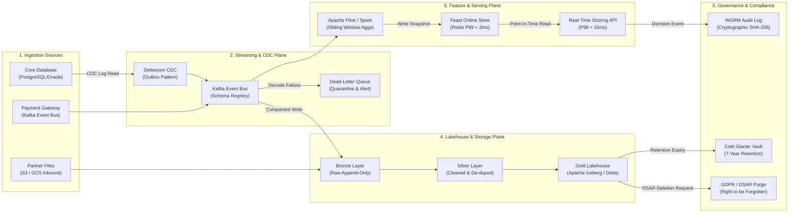

# Source-to-Target Mapping (STTM) & Data Engineering Specification

**Document Code:** `BS-TMPL-DATA-01`  
**Phase:** Phase 2 — Data Engineering (Step 2.1 – 2.4)  
**Standard:** Enterprise Data Contract & Lakehouse Ingestion Specification  

---

## 1. Pipeline & Ingestion Architecture Metadata

* **Source System Categories:**
  * Core Transactional DB (`PostgreSQL` 16 / `Oracle` 19c via Debezium CDC)
  * Event Streaming Bus (`Apache Kafka` 3.8 / `Redpanda` with Avro schema registry)
  * External Partner APIs (`REST` with mTLS and webhook callbacks)
  * Batch Ingestion Files (`S3 / GCS` Parquet dumps from billing / CRM)
* **Ingestion Method:** Hybrid (Real-time CDC for scoring velocity + Hourly batch compaction for training lakehouse)
* **Semantics:** Event-time semantics with 15-minute watermark bound for late-arriving records.
* **Volume Assumptions:**
  * Steady state: 5,000 events/sec
  * Peak volume: 15,000 events/sec
  * Daily uncompressed ingest: ~450 GB/day (~1.3 billion records/month)
* **Refresh Frequency:**
  * Online Feature Store: P95 &le; 2.5s from event occurrence to Redis availability
  * Offline Lakehouse: Hourly micro-batch compaction into Apache Iceberg tables

---

## 2. End-to-End Data Lifecycle Architecture



---

## 3. Field-Level Source-to-Target Mapping Specification

| Target Feature Name | Target Type | Source System & Table | Source Column(s) | Transformation / Business Logic | Null Handling & Default | Leakage Prevention Rule | Owner |
| :--- | :--- | :--- | :--- | :--- | :--- | :--- | :--- |
| `entity_id` | `VARCHAR(64)` | `core.transactions` | `user_id` | Trim, lowercase, strip special characters | Mandatory (Drop if NULL) | Entity join key | Data Eng |
| `event_time` | `TIMESTAMP_NTZ` | `core.transactions` | `created_at` | Convert to UTC ISO-8601; extract millisecond epoch | Mandatory (Reject event) | Primary time anchor for PIT joins | Data Eng |
| `tx_amount_cents` | `INTEGER` | `core.transactions` | `amount` | `ROUND(amount * 100)` (store in cents) | Default: `0` | Snapshot value at transaction time | Data Eng |
| `tx_velocity_1h` | `INTEGER` | `core.transactions` | `transaction_id` | Sliding window count over last 3,600s in Redis | Default: `1` | Strictly excludes current tx | Feature Eng |
| `amount_zscore_30d`| `FLOAT` | Aggregated Store | `amount`, `avg_30d`, `std_30d` | `(amount - avg_30d) / NULLIF(std_30d, 0.0)` | Default: `0.0` | Computed from prior matured days | Data Sci |
| `country_mismatch` | `BOOLEAN` | `core.transactions` | `card_country`, `ip_country` | `CASE WHEN card_country != ip_country THEN 1 ELSE 0 END` | Default: `0` | Evaluated at decision time | Feature Eng |
| `device_age_days` | `FLOAT` | `core.devices` | `first_seen_at`, `created_at` | `EXTRACT(EPOCH FROM (created_at - first_seen_at)) / 86400` | Default: `0.0` (new device) | Must not use future device updates | Feature Eng |
| `merchant_risk_7d` | `FLOAT` | `lakehouse.merchant_stats`| `matured_fraud_cnt`, `tx_cnt` | `(matured_fraud_cnt + 1.0) / (tx_cnt + 100.0)` | Default: `0.01` (prior) | Includes only matured fraud labels | Data Sci |

---

## 4. Late-Arriving Data, Deduplication & Backfill Protocols

### 4.1 Late-Arriving Event Policy
* **Watermark Threshold:** 15 minutes allowed lateness.
* **In-Window Arrival:** If `event_time >= current_watermark - 15m`, update sliding window aggregations and feature cache.
* **Out-of-Window Arrival:** Route directly to side-output Kafka topic (`data.transactions.late_arriving`) for offline historical lakehouse reconciliation; do not mutate real-time cache.

### 4.2 Deduplication & Idempotency
* **Deduplication Key:** `SHA-256(entity_id + event_time + tx_amount_cents + merchant_id)`.
* **Deduplication Window:** Redis sliding Bloom filter + 24-hour TTL key lookup (`SETNX`). Duplicate event submissions return existing cached score without re-triggering inference.

### 4.3 Backfill & Replay Isolation
* **Zero Live Impact:** Backfill jobs execute in isolated namespace (`lakehouse.backfills_v2`) reading historical CDC snapshots.
* **Rate Throttling:** Backfill writer throttled to maximum 20% of provisioned lakehouse write IOPS.
* **Atomic Pointer Swap:** The production table view pointer is updated via metadata manifest swap only after row-count reconciliation (&Delta; &le; 0.001%) and distribution KS-test pass (p-value &gt; 0.05).

---

## 5. Machine-Readable Schema Specifications

### 5.1 JSON Schema Specification (`contracts/schema-event.json`)
```json
{
  "$schema": "https://json-schema.org/draft/2020-12/schema",
  "title": "TransactionEvent",
  "type": "object",
  "required": ["entity_id", "event_time", "amount_cents", "currency"],
  "properties": {
    "entity_id": {
      "type": "string",
      "minLength": 8,
      "maxLength": 64
    },
    "event_time": {
      "type": "string",
      "format": "date-time"
    },
    "amount_cents": {
      "type": "integer",
      "minimum": 1,
      "maximum": 1000000000
    },
    "currency": {
      "type": "string",
      "pattern": "^[A-Z]{3}$"
    },
    "device_id": {
      "type": "string"
    }
  },
  "additionalProperties": false
}
```

### 5.2 Apache Avro Schema (`contracts/transaction-event.avsc`)
```json
{
  "type": "record",
  "name": "TransactionEvent",
  "namespace": "com.brainsiphon.contracts.events",
  "fields": [
    { "name": "entity_id", "type": "string" },
    { "name": "event_time_epoch_ms", "type": "long" },
    { "name": "amount_cents", "type": "long" },
    { "name": "currency", "type": "string" },
    { "name": "merchant_id", "type": "string" },
    { "name": "is_card_present", "type": "boolean", "default": false },
    { "name": "schema_version", "type": "int", "default": 1 }
  ]
}
```

---

## 6. Data Governance, Retention & Access Controls

* **Data Ownership:** Core Payment Engineering (Source) &rarr; Data Platform Team (CDC/Kafka) &rarr; ML Engineering (Feature Store).
* **Classification:** Sensitive Financial Data (PCI-DSS &amp; GDPR Scope). Full PAN numbers stripped at ingestion boundary; only HMAC-SHA256 tokens stored.
* **Retention Lifecycle:**
  * Redis Online Store: Sliding 30-day TTL per entity.
  * Gold Iceberg Lakehouse: 24 months hot storage for model training and backfills.
  * WORM Audit Vault: 7 years cold archival with SHA-256 cryptographic chain sealing.
  * Right to be Forgotten (GDPR Article 17): Automated crypto-shredding via individual user key destruction.
