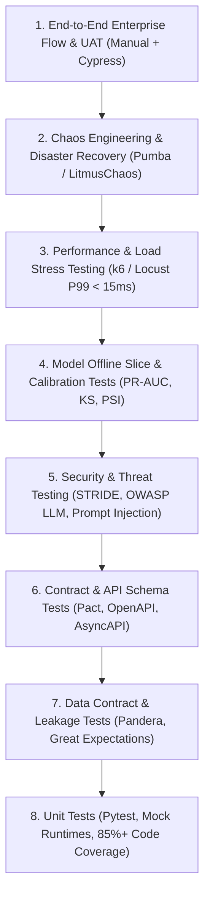

# Master Test Strategy & Quality Engineering Framework

**Document Code:** `BS-TMPL-TEST-01`  
**Phase:** Phase 4 — Platform, Security and Verification (Step 4.3 – 4.7)  
**Standard:** ISO/IEC/IEEE 29119 & NIST AI RMF Test Guidelines  

---

## 1. Multi-Tier Testing Pyramid



---

## 2. Standard Test Suites & Release-Blocking Thresholds

| Test Tier | Scope & Tooling | Execution Cadence | Release Blocking Gate Criteria |
| :--- | :--- | :--- | :--- |
| **Unit Tests** | `pytest tests/unit/` | Every PR commit | 100% pass; statement coverage &ge; 85%. |
| **Data Quality** | `python data-quality-suite.py` | Nightly / Pre-training | 0 duplicate keys; null rate &le; 0.01%; 0 future-dated records. |
| **Feature Leakage** | `pytest test_future_truncation` | Every feature PR | Truncating future rows yields &Delta; = 0.0000 on past features. |
| **Model Gates** | `python baseline.py` | Model candidate promotion | Challenger PR-AUC &ge; Baseline PR-AUC; 95% bootstrap CI lift &gt; 0. |
| **Slice Floors** | Slice evaluation across merchant/device | Pre-staging release | No cohort with &ge; 200 events drops &lt; 50% of aggregate recall. |
| **API Contracts** | `pytest tests/test_api_contracts.py` | Staging deploy | 100% compliant with OpenAPI 3.1 &amp; AsyncAPI 3.0 schema. |
| **Security & Threat** | Prompt injection &amp; tool jailbreaks | Security audit | 0 unhandled prompt injection bypasses; 0 SSRF tool calls. |
| **Load & Latency** | `k6 run tests/load/k6-p99-spike.js` | Pre-production gate | P99 latency &le; 15ms at 1.5&times; peak load (15,000 QPS). |
| **Chaos Resilience** | Redis kill / Kafka partition outage | Quarterly game-day | Circuit breaker trips; fails safely to rules without 5xx. |
| **Disaster Recovery** | Regional failover drill | Bi-annual drill | RTO &lt; 5 minutes; RPO = 0 for committed ledger records. |

---

## 3. Test Execution Commands & Reproducibility
```bash
# 1. Run complete unit and contract suite
pytest -v -k "not load"

# 2. Run data quality and leakage verification
python features.py --verify-no-leakage

# 3. Execute performance load test
k6 run --vus 100 --duration 5m tests/load/k6-soak.js

# 4. Validate security guardrails against adversarial test set
python -m pytest tests/security/test_prompt_injection.py
```

