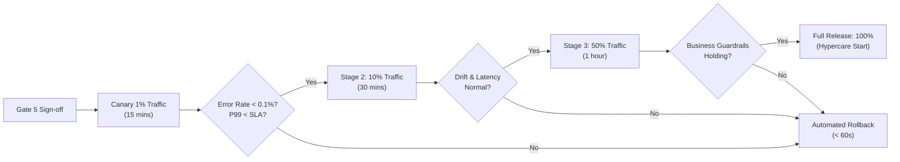

# Production Release Checklist (Gate 5 Go-Live Readiness)

> **Document ID:** `BS-REL-CHK-01`  
> **System / Blueprint:** `[System Name / Blueprint ID]`  
> **Release Target Version:** `v[X.Y.Z]`  
> **Deployment Window:** `[YYYY-MM-DD HH:MM UTC]`  
> **Release Commander:** `[Name / Lead SRE]`  
> **Gate Status:** `[PENDING / APPROVED FOR CANARY / PROD DEPLOYED]`

---

## 1. Pre-Deployment Verification Gate (T - 48 Hours)

All checkboxes in this section are hard requirements. Any unchecked box requires explicit written waiver from the Release Commander.

- [ ] **Code & Artifact Immutability:**
  - Git tag pinned (`git tag -a vX.Y.Z -m "Release vX.Y.Z"`).
  - Container images signed via Cosign / Sigstore and pushed to internal container registry with SHA256 digest pinning.
  - Model artifacts serialized, pinned, and registered in MLflow / Model Registry with status `Production`.
- [ ] **Infrastructure & Environment Validation:**
  - Infrastructure-as-Code dry-run executed (`terraform plan`) with zero unexpected resource deletions.
  - Kubernetes cluster capacity and node group quotas verified across all Availability Zones.
  - Database schema migrations tested backward-compatible in Staging (no column drops, additive only).
  - IAM service account roles, workload identities, and KMS key access verified.
- [ ] **Automated Test & Compliance Suite Passed:**
  - Unit, integration, and contract tests passed with $\ge 85\%$ line coverage.
  - Load and stress tests verified: System meets P99 latency SLA at $1.5\times$ expected peak load.
  - Security vulnerability scan clean (0 Critical, 0 High vulnerabilities in container image and dependencies).
  - Independent Model Validation sign-off obtained (`BS-VAL-REP-01`).
- [ ] **Operational & Monitoring Readiness:**
  - Prometheus/Datadog dashboards provisioned and validated for system SLIs.
  - PagerDuty / Opsgenie alert routing rules active for SEV-1 and SEV-2 on-call engineers.
  - Operational Runbook updated and verified (`BS-SRE-RBK-01`).
  - Rollback plan reviewed and dry-run executed in Pre-Production (`BS-REL-ROL-01`).

---

## 2. Mandatory Gate 5 Sign-Off Matrix

| Role | Signer Name | Decision | Timestamp | Comments / Exceptions |
|---|---|---|---|---|
| **Executive Sponsor** | `[Name]` | APPROVED / REJECTED | `[ISO-8601]` | Funding & strategic release approval |
| **Product Owner** | `[Name]` | APPROVED / REJECTED | `[ISO-8601]` | Business acceptance criteria verified |
| **Lead Solution Architect** | `[Name]` | APPROVED / REJECTED | `[ISO-8601]` | Architecture & NFR adherence verified |
| **Lead SRE / Platform Eng** | `[Name]` | APPROVED / REJECTED | `[ISO-8601]` | Operational readiness & telemetry confirmed |
| **Chief Information Security Officer** | `[Name]` | APPROVED / REJECTED | `[ISO-8601]` | Security & penetration test clean |
| **Risk & Compliance Officer** | `[Name]` | APPROVED / REJECTED | `[ISO-8601]` | Regulatory & data residency compliance |

---

## 3. Canary Deployment Execution Timeline

### Stage Milestones
1. **Stage 1 (1% Traffic - 15 minutes):**
   - Direct 1% of live traffic to the canary deployment.
   - Verify health check endpoints (`/healthz`, `/readyz`).
   - Monitor error rate ($\text{HTTP 5xx} < 0.05\%$) and P99 latency.
2. **Stage 2 (10% Traffic - 30 minutes):**
   - Increase traffic to 10%.
   - Verify prediction score distribution matches baseline (Kolmogorov-Smirnov / PSI drift check).
   - Verify downstream Kafka event publishing and database persistence.
3. **Stage 3 (50% Traffic - 60 minutes):**
   - Increase traffic to 50%.
   - Monitor business guardrail metrics (e.g. false decline rate, alert volume).
4. **Stage 4 (100% Traffic - Production Promoted):**
   - Promote canary to full production workload.
   - Terminate legacy pods after graceful drain window (300 seconds).

---

## 4. Hypercare & Post-Release Monitoring

- **Hypercare Duration:** 14 calendar days post-deployment.
- **Standup Cadence:** Daily 15-minute operational sync with SRE, ML Engineer, and Product Owner.
- **Key Metrics Under Observation:**
  - Service Availability (Target: $\ge 99.95\%$)
  - Feature Freshness & Streaming Lag (Target: $< 500\text{ ms}$)
  - Daily Ingestion Volume & Dead-Letter Queue Count (Target: $0$ unhandled DLQ messages)
  - Daily Active Inference Requests vs Baseline

