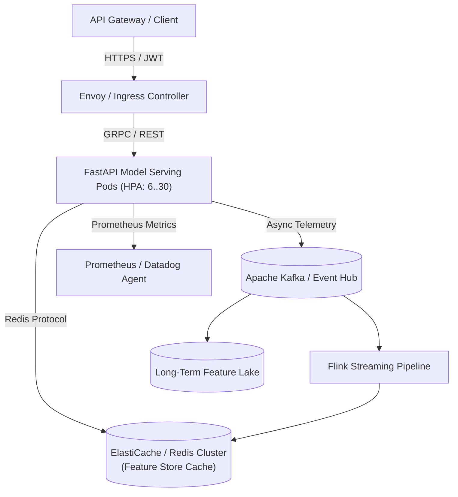

# SRE Operational Runbook & Incident Response Guide

> **Document ID:** `BS-SRE-RBK-01`  
> **Service Name:** `[Service Name / Blueprint ID]`  
> **Primary On-Call Rotation:** `sre-ml-platform-primary`  
> **Secondary Escalation:** `ml-engineer-lead` / `data-engineer-lead`  
> **Critical Tier:** `Tier 1 (Core Transactional / Mission-Critical)`

---

## 1. Incident Severity Definitions & Response SLAs

| Severity | Definition | MTTA (Ack) | MTTR (Mitigate) | Escalation Requirement |
|---|---|---|---|---|
| **SEV-1 (Critical)** | Complete service outage, data corruption, or $> 5\%$ transaction drop. | $< 5\text{ mins}$ | $< 30\text{ mins}$ | VP Eng, Head of Product, On-call SRE, ML Lead |
| **SEV-2 (Major)** | P99 latency breach ($> 30\text{ ms}$), fallback rules active, feature staleness $> 15\text{ mins}$. | $< 15\text{ mins}$ | $< 2\text{ hours}$ | SRE Team, Senior ML Engineer |
| **SEV-3 (Minor)** | Minor drift detected, non-blocking batch failure, metric reporting delayed. | $< 1\text{ hour}$ | $< 1\text{ business day}$ | Ticket created in engineering backlog |
| **SEV-4 (Informational)**| Routine alert, low-severity certificate expiration warning (> 30 days). | $< 1\text{ business day}$| Next sprint | System maintainer |

---

## 2. Architecture & Service Topology Map



---

## 3. Incident Triage Playbooks

### Playbook A: P99 Latency Breach (> 30ms) or 504 Gateway Timeouts
**Symptoms:** Datadog alert `[ALERT] P99 Latency > 30ms for 3m`; Grafana shows upstream 504s.

**Diagnostic Commands:**
```bash
# 1. Check pod status and restart counts
kubectl get pods -n brainsiphon-prod -l app.kubernetes.io/name=ai-solution -o wide

# 2. Check CPU / Memory throttling on serving pods
kubectl top pods -n brainsiphon-prod -l app.kubernetes.io/name=ai-solution

# 3. Inspect Redis connection latency and cache hit ratio
redis-cli -h redis-prod.internal -p 6379 INFO stats | grep -E "instantaneous_ops|keyspace_hits|keyspace_misses"

# 4. Check pod logs for slow feature retrieval
kubectl logs -n brainsiphon-prod -l app.kubernetes.io/name=ai-solution --tail=100 | grep -E "FEATURE_FETCH_TIMEOUT|SLOW_INFERENCE"
```

**Remediation Actions:**
1. If pods are CPU-throttled, manually scale replicas:
   ```bash
   kubectl scale deployment/ai-solution --replicas=20 -n brainsiphon-prod
   ```
2. If Redis latency $> 5\text{ ms}$, verify network partition or memory saturation. Enable local memory fallback cache via feature flag.
3. If inference engine is degraded, activate lightweight heuristic fallback ladder:
   ```bash
   redis-cli -h redis-prod.internal SET "config:inference_mode" "fast_heuristic_fallback"
   ```

---

### Playbook B: Feature Store Staleness / Streaming Ingestion Lag
**Symptoms:** Alert `Kafka Consumer Lag > 10,000 records`; feature values unchanged for $> 10\text{ minutes}$.

**Diagnostic Commands:**
```bash
# 1. Check consumer group lag
kafka-consumer-groups.sh --bootstrap-server kafka-broker.internal:9092 \
  --describe --group feature-streaming-consumer-group

# 2. Check Flink job status
flink list -m flink-jobmanager.internal:8081
```

**Remediation Actions:**
1. Check if Kafka broker has partition imbalance. Restart stalled consumer tasks.
2. If schema validation error causes repeated consumer crashes, divert poisoned messages to Dead-Letter Queue (DLQ):
   ```bash
   curl -X POST http://feature-pipeline.internal/admin/dlq/skip-malformed -d '{"max_records": 50}'
   ```
3. Restart streaming workers with increased parallelism.

---

### Playbook C: Sudden Model Drift / Score Collapse (Anomaly in Distribution)
**Symptoms:** Evidently AI / Evidently Cloud alert: `PSI > 0.25 on primary fraud score`; unexpected surge in customer false declines.

**Diagnostic Commands:**
```bash
# 1. Check current score distribution vs historical baseline
python scripts/check_drift_metrics.py --window 1h --baseline 7d

# 2. Inspect upstream feature distributions
python scripts/inspect_feature_distributions.py --features "amount_usd,device_risk_score,velocity_1h"
```

**Remediation Actions:**
1. Verify if an upstream payment gateway released an unannounced schema change or currency conversion bug.
2. If data source is corrupted, switch scoring threshold temporarily or divert traffic to incumbent champion model:
   ```bash
   kubectl patch configmap ai-solution-config -n brainsiphon-prod \
     --type merge -p '{"data":{"ACTIVE_MODEL":"champion-v1.2.0","OVERRIDE_REASON":"DRIFT_INCIDENT"}}'
   kubectl rollout restart deployment/ai-solution -n brainsiphon-prod
   ```

---

## 4. Routine Maintenance & Health Verification

- **Log Rotation & Disk Hygiene:** Automated via Kubernetes logrotate DaemonSet.
- **Certificate Renewal:** Managed via cert-manager (Let's Encrypt / Vault PKI). Alerts fire at $T-30$ days.
- **Weekly Disaster Recovery Dry-Run:** Verified automated cross-region snapshot replication every Wednesday at 04:00 UTC.

