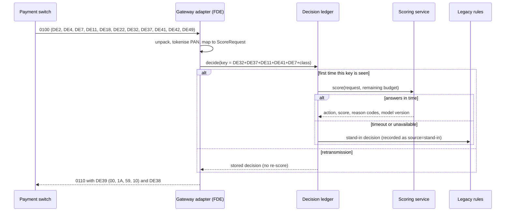

# Payment-switch integration: card and UPI

Four layers, separated on purpose. A change in one never forces a change in another.

| Layer | What | Here | Owner |
|-------|------|------|-------|
| 1. External protocol | ISO 8583 over TCP (cards), NPCI UPI ReqPay/RespPay (UPI) | `iso8583.py`, `upi.py` | Switch / PSP / acquirer |
| 2. Connector and transformation | Frame, parse, tokenise, map to the internal schema, idempotent decide, map back | `gateway.py`, `mapping.py`, `ledger.py` | FDE |
| 3. Internal contract | `ScoreRequest` / `ScoreResponse` | `contracts/*.schema.json` | Solution architect + AI engineer |
| 4. Downstream acknowledgement | ISO 0110/0210 response with DE39, or RespPay | `to_switch_response`, `build_respay` | Switch / PSP |

## Message types and what the gateway does with each

| MTI | Meaning | Gateway behaviour | Idempotency | Response |
|-----|---------|-------------------|-------------|----------|
| 0100 / 0101 | Authorisation request / repeat | Score once per key | Key `(DE32, DE37, DE11, DE41, DE7, class, function)`; 0101 is the same transaction as 0100 | 0110 |
| 0200 / 0201 | Financial request (purchase, cash) | As 0100 | As above | 0210 |
| 0120 / 0220 | Advice (stand-in processed elsewhere) | Record only, **never decline** | Recorded once per key | 0130 / 0230 (`00`) |
| 0400 / 0420 | Reversal | Mark the original reversed through DE90; unknown original is an orphan, still accepted | Reversal key is distinct from the original | 0410 / 0430 (`00`) |
| 0800 | Network management (echo, key change) | Acknowledge | n/a | 0810 |
| any malformed | | Format error `30`, no scoring | n/a | 0110 with `30` |

## Data-element mapping (request direction)

| DE | Name | Internal field | Rule |
|----|------|----------------|------|
| 2 | PAN | `card_token`, `bin` | Tokenised in `to_score_request`; the clear PAN is never logged, stored or sent to the model |
| 3 | Processing code | `txn_type` | `00` purchase, `01` cash, `09` purchase with cashback, `20` refund |
| 4 | Amount | `amount_minor`, `amount` | Minor units; decimals from the currency exponent (DE49), not assumed to be 2 |
| 7 | Transmission date/time | `event_time` (UTC) | MMDDhhmmss, year inferred; part of the idempotency key |
| 11 | STAN | `stan` | Key component |
| 18 | MCC | `mcc` | |
| 22 | POS entry mode | `entry_mode`, `pin_verified` | `051` chip, `071` contactless, `812` e-commerce; third digit `1` = PIN capable |
| 32 | Acquirer id | `acquirer_id` | Key component |
| 37 | RRN | `rrn` | Key component |
| 41/42 | Terminal / merchant | `terminal_id`, `merchant_id` | |
| 49 | Currency | `currency` | ISO 4217 numeric (`356` INR) |
| 55 | EMV data | `emv_present` | The **HSM** verifies the cryptogram (ARQC). The scorer only learns that EMV data was present |
| 90 | Original data elements | reversal lookup | MTI(4) STAN(6) time(10) acquirer(11) forwarder(11) |

## Response mapping

| Decision | DE39 | Notes |
|----------|------|-------|
| ALLOW | `00` | DE38 carries a six-character authorisation id derived from RRN and STAN |
| ALLOW with approved amount below the request | `10` partial approval | Only when the switch says it supports partials (`partial_supported`): DE4 keeps the request, DE54 carries the approved amount. Otherwise the gateway answers `1A`: it never silently approves less |
| STEP_UP | `1A` | Visa-style "additional customer authentication required". Confirm the code with each acquirer (some use `65` or `70`) |
| BLOCK | `59` | Suspected fraud. `05` (do not honour) if the issuer prefers not to disclose |
| Same key, different payload | `94` | A conflict, never a replay |
| Scoring too slow or down | per fallback policy | Recorded as `stand-in`; the decision still goes into the ledger once |

## Acquirer-specific mapping: use a profile, not an edit

Private fields (DE48, DE60, DE62, DE63), EMV tag selection in DE55, extra response codes and the bitmap encoding differ per acquirer.
For each acquirer, create `profiles/<acquirer>.json` listing: bitmap encoding (hex/binary), extra field definitions, response-code
overrides, which DE48 sub-elements carry device or 3-D Secure data, and the partial-approval convention. The field table in
`iso8583.py` stays the common subset. Keep the acquirer's interface specification with the evidence for this stage.

## Duplicates, reversals, timeouts and the ambiguity between them

- **Retransmission.** The switch times out and sends the same request again (0101 or 0100 with the same STAN/RRN). The ledger returns the stored decision; the model is not called again, so the answer cannot change between attempts. Test: `test_duplicate_transmission_returns_the_stored_decision_without_rescoring`.
- **Concurrent retransmission.** Eight identical requests arrive together: one scores, seven wait and receive its result. Test: `test_concurrent_retransmissions_are_scored_exactly_once`.
- **Late answer.** The switch gave up at 5 ms; the gateway finishes at 30 ms and stores the decision. The retry gets it instantly. The switch must discard a late response to an expired request (that is the switch's rule: confirm it).
- **Timeout ambiguity.** If the gateway answered from the fallback because the model was slow, the stored decision is the fallback decision. A recovered model does not rewrite it.
- **Reversal of an approved transaction** marks the ledger row reversed; **reversal of an unknown original** is accepted (ISO practice: never refuse a reversal) and recorded as an orphan for reconciliation.
- **Advice** reports what already happened at stand-in; record it and never decline.
- **Duplicate financial actions** are prevented upstream of the model: the gateway never writes to the ledger of money, only returns a code. If the customer's design has the fraud service call a block/step-up action API, that call carries `transaction_id` as its idempotency key.

## HSM, keys and the cryptographic boundary

Generic application secrets management is **not** sufficient for payments. Record, with the customer's payment-security team:

| Item | Decision to record |
|------|--------------------|
| What the scorer may see | Token, BIN, amount, MCC, entry mode, device signals. Never PAN, PIN block, track data or EMV cryptograms |
| Tokenisation | Vault or HSM-backed, format-preserving or keyed-hash; deterministic so joins work; token scope per environment |
| Who verifies ARQC/ARPC, translates PIN blocks | The customer's HSM/switch. Not this service |
| Key hierarchy | LMK/master -> zone keys (ZMK/ZPK/ZAK) -> working keys. Who is key custodian; dual control and split knowledge |
| Rotation | Token key: overlap window, both ids verify (`hsm.SoftwareTokeniser.rotate`), re-tokenise historical features, then retire. Working keys: switch-driven via 0800 key change |
| Boundary evidence | Network diagram showing the HSM subnet, which services call it, and the audit log of key operations |

`SoftwareTokeniser` is a development mock. Replace it behind `Tokeniser` with the customer's vault or HSM client (PKCS#11, payShield host commands, AWS Payment Cryptography, Azure Payment HSM).

## Identity: people and machines are different problems

| Plane | Who | Mechanism | Owner |
|-------|-----|-----------|-------|
| Workforce | Fraud analysts, leads, auditors | OIDC SSO with MFA; roles `analyst`, `approver`, `auditor`; maker-checker on rule or threshold changes | Customer IAM |
| Machine | Payment switch -> gateway; gateway -> scorer; scorer -> feature store; partner switches | mTLS with workload identity (SPIFFE or cloud workload identity) plus per-partner client certificates; no shared secrets | Platform + payments security |
| Partners | Acquirers, UPI PSP | Their own certificate, IP allow-list, key-exchange procedure | Partner onboarding |

Never reuse an analyst's identity for a service, or a service credential in a person's tool.

## Sandbox and certification, per partner

1. **Card switch / acquirer**: request the certification test plan and host simulator. Run `replay` against the gateway with the acquirer's test cases. Required evidence: message log for each certification case, DE39 mapping signed by the acquirer, key-exchange record.
2. **UPI**: through the sponsor PSP bank: sandbox VPA set, test certificates, NPCI UAT cases (collect, pay, mandate, timeout/deemed, reversal). Replace `upi.py` with a parser generated from NPCI's current schema; keep the mapping in `upi_to_score_request`.
3. **Card network certification** (when the customer is an issuer processor): the network's own host-to-host test; allow weeks.
4. Record each partner in the connector registry with the version tested and the date.

## PCI scope validation checklist (FDE)

- [ ] Data-flow diagram marks where the PAN enters and leaves; the scoring service, feature store, logs and model telemetry are **outside** cardholder-data scope
- [ ] Tokenisation happens at the gateway edge, before any log line; log scrubbing test attached (search the logs for the test PAN)
- [ ] Network segmentation: gateway in the CDE-adjacent segment; scoring and features in a segment with no route from the internet
- [ ] Masking in analyst tools: last four only, with an audited reveal
- [ ] No PAN in test fixtures: the PANs in `fixtures/` are the public test numbers
- [ ] Audit evidence collected: segmentation test, tokenisation test, log scan, access review, HSM key ceremony record
- [ ] The QSA has seen the diagram and agreed the scope **before** go-live

## Shadow replay, canary and the way back

1. **Replay** recorded switch traffic through the gateway (`replay.replay`): latency percentiles at the *switch side* and agreement with the legacy engine. Exit: p99 inside the budget with headroom, no timeouts, disagreements explained.
2. **Shadow**: the gateway scores and records but answers with the legacy decision (`Canary(pct=0)` with shadow logging), for at least one full business cycle.
3. **Canary**: `Canary(pct=1)` then 5, 25, 50, 100. Assignment is per card, stable. Guardrails: stand-in rate, latency, false-decline rate.
4. **Automatic rollback**: when the stand-in rate over the last window exceeds the limit, `Canary` sets `pct=0` and every request takes the legacy path; `ramp()` refuses until someone clears it with `reset()` after a review.
5. **Manual rollback**: set the canary to 0 (a configuration change, not a deployment), then confirm with the replay that all responses carry `source=legacy`.

## Post-deployment reconciliation

Run daily (`reconcile.reconcile`): decisions from the ledger against the switch's outcome file, chargebacks and confirmed-fraud labels.
The report separates: decisions the switch did not follow, fraud we allowed, probable false declines (declined, then the same card and amount succeeded within ten minutes), and anything with no counterpart. Owners: payments operations (switch mismatches), fraud analytics (allowed fraud, false declines). Weekly review; the false-decline rate is a release guardrail.
