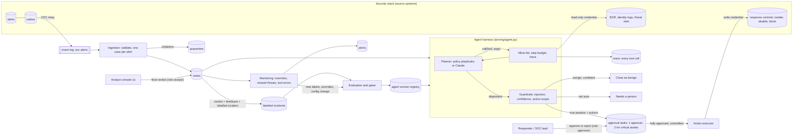

# Architecture

## What bounds the agent

The planner (a set of playbooks, or a model) chooses the next tool call and the conclusion. It is treated as untrusted.
These controls are code in the harness and hold whatever the planner does; `tests/test_01_harness.py` attacks each one.

| Control | Enforced in | What it stops |
|---|---|---|
| Tool allow-list from configuration | `agent.investigate: call` | Calling anything that is not one of the four read-only tools |
| Argument validation in every tool | `serving/tools.py` | Injection through tool arguments; unbounded outputs |
| Step budget | `agent.investigate: call` | Loops and runaway cost; an exhausted budget sends the case to a person |
| Full trace | `agent_steps` table | Decisions nobody can reconstruct |
| Injection check over all evidence | `agent.investigate` | A benign verdict on a case whose telemetry addresses the agent |
| Confidence rule | `agent.investigate` | Auto-closing on a weak benign verdict |
| Action scope | `agent.investigate` | Actions of an unknown type, or on an asset that is not this alert's host, user or source IP |
| No write tool; a separate executor | `serving/actions.py` | The agent changing anything by itself. It holds no credential that can |
| Approval with four-eyes | `bsref/hitl.py`, `configs/pipeline.yaml` | One person (or the agent) containing a critical asset alone; self-approval |
| Decide, commit, then execute | `api/service.decide_approval`, `actions.settle` | An action executed for a decision that was rolled back |
| Evaluation gates | `training/train.py` | Promoting a version that misses threats, acts on benign cases or obeys planted text |

## Design decisions

| Decision | Why | What would change it |
|---|---|---|
| The agent proposes, people approve, a separate component executes | Containment is disruptive and sometimes irreversible; the cost of a wrong action is an outage | Low-impact, reversible actions with months of clean approval history: auto-approve those types, keep the audit |
| Escalation is a first-class outcome | A missed attack costs far more than an analyst's ten minutes | Never; tune the rate, not the principle |
| "Decided accuracy" and "escalation rate" are gated separately | One number hides the trade: escalating everything is perfectly accurate and useless | Never |
| The labelled suite grows from analyst verdicts | Playbooks and prompts drift from what the SOC sees; yesterday's surprises become tomorrow's tests | Verdict quality problems: add a second reviewer before a case enters the suite |
| The configuration is the versioned artefact | For an agent, a prompt or threshold change is a release and needs the same gates and rollback | A fine-tuned model: version the weights too |
| A deterministic planner as the default | The repository must run and be testable offline with stable results | Any real deployment: use the model planner and re-run the evaluation |

## What is real and what you replace

| Concern | In this repository | In production |
|---|---|---|
| Alerts | A simulated SIEM writing an outbox | Your SIEM's webhook or queue, through the same contract |
| Tools | SQL reads of simulated telemetry | API calls to the EDR, identity provider and threat-intelligence platform with a read-only credential |
| Action executor | SQL updates of simulated controls | API calls with a separate, narrowly scoped write credential held only by the executor |
| Planner | Deterministic playbooks (default) or Claude | A model, evaluated on your own closed incidents before it investigates anything |
| Labelled incidents | 24 synthetic scenarios with known truth | An export of your closed, reviewed incidents: this is the asset that makes the agent measurable |
| Approvals | A table and an API | The same, or your ticketing / chat-ops approval flow calling the API |
| Identity | Local token issuer with three demo users | `AUTH_MODE=oidc`; map groups to `analyst`, `approver`, `agent-admin` |

Not implemented here: multi-alert correlation into incidents, long-running investigations with memory, cost tracking for
the model planner, sandboxed execution of analysis code, and automatic expiry sweeps (overdue approvals are expired when the
queue is read; schedule `service.expire()` in production).

## Adapting it

For another agent that investigates and proposes actions (IT operations, claims handling, account reviews), change the
event contract (`data/`), the tools and their argument validation (`serving/tools.py`), the action types, their scope rule
and their approval requirements (`serving/agent.py`, `serving/actions.py`, `configs/pipeline.yaml`), the planner prompt or
playbooks (`serving/planners.py`), and above all the labelled suite. Keep the harness, the approval flow, the evaluation
and the gates. For a read-only agent, delete `serving/actions.py` and the approval routes; everything else stands.
