# Architecture

```mermaid
flowchart LR
  subgraph Source["Source system (ERP / point of sale)"]
    SL[(core_sales)] --- OB[(outbox)]
  end
  OB -- "CDC relay: day closed, restated, promo planned" --> LOG[["event log: sales.events"]]
  LOG -- "consumer group sales-ingest" --> ING[Ingestion: validate, upsert by source sequence]
  ING -- violations --> Q[(quarantine)]
  ING --> SD[(sales_daily)]
  ING --> PP[(promo_plan)]
  SD --> FB[features/build.py: origin-safe features]
  PP --> FB
  FB --> TRAIN[Rolling-origin backtest, band calibration, gates]
  TRAIN --> REG[(model registry)]
  FB --> RUN[Nightly forecast run]
  REG --> RUN
  RUN -- "completeness and contract checks" --> RUN
  RUN --> FC[(forecasts: p10, p50, p90, baseline, final)]
  RUN -- "implausible series" --> REV[(review queue)]
  PL[Planner console /ui] -- "accept, keep baseline, override (role planner)" --> REV
  REV --> FC
  RS[Replenishment system] -- "GET /v1/forecasts (JWT, role consumer)" --> API[Forecast API] --> FC
  SD -- "actuals arrive" --> ACC[Accuracy: forecasts vs actuals, overrides vs model]
  FC --> ACC
  ACC --> MON[Monitoring job] --> AL[(alerts)] --> HOOK[Webhook / Alertmanager]
  MON -- "new data, age or live error" --> RET[Retraining trigger] --> TRAIN
```

## The nightly chain

1. The ERP closes the day. Each series' row, any restatement of an earlier day and newly planned promotions are in the outbox.
2. CDC relays them; ingestion validates each row and upserts it. The source sequence number decides which change is newest.
3. The forecast run picks the newest day for which at least 90% of series have reported. If none of the last three days
   qualifies, the run is refused: no forecast is better than a silently biased one.
4. The input window is validated against its contract. Features are built by the same function the backtest used.
5. The production model predicts p10, p50 and p90 for 14 days. Each series' total is compared with its recent sales; an
   implausible one is held, a review task is created, and consumers receive the seasonal-naive baseline for it meanwhile.
6. The run and all its rows are written in one transaction under the id (origin day, model version). A retry is a no-op.
7. As actuals arrive, every forecast and every override is scored. That accuracy is what the alerts and the retraining
   trigger read.

## Design decisions

| Decision | Why | What would change it |
|---|---|---|
| Batch, not online | Replenishment decides once a day; a request-time model would add cost and failure modes for no benefit | Intraday re-forecasting: run the same job more often before considering online inference |
| One global model on level-normalised demand | 200 short series share seasonality and promotion effects; a model per series would overfit | Thousands of series in distinct regimes: cluster, or add series embeddings |
| Stock-out days are censored | Recorded sales on a stock-out day understate demand; treating them as demand teaches the model to under-forecast | A real lost-sales estimate from inventory data: impute instead of dropping |
| Promotion plan as a feature | It is known in advance and is the largest driver; using realised promo flags would not be available at forecast time | Unplanned promotions: add a promo-nowcast input and measure it |
| Rolling-origin backtest with a horizon gap | A random split leaks the future; targets of training origins must end before calibration begins | Longer horizons: widen the gap accordingly |
| Band calibrated on held-out origins | Raw quantile models are often too narrow or wide; planners set safety stock from the band | Conformal prediction per horizon when coverage differs by horizon |
| Held series get the baseline, not nothing | A missing forecast stops replenishment; a simple, explainable number is the safe default | A domain where a wrong number is worse than none: return an explicit "no forecast" status |
| Overrides are scored | Human adjustments are valuable sometimes and harmful on average in many organisations; measure it | Never: always measure it |

## What is real and what you replace

| Concern | In this repository | In production |
|---|---|---|
| Source system | `data/source_system.py` simulates the ERP | Your ERP / POS. Keep the outbox contract; delete the simulator |
| CDC | A poller over the outbox table | Debezium or the vendor's change feed; nightly file drops also fit (land them through the same contract) |
| Event log | A PostgreSQL / SQLite table with offsets and a DLQ | Kafka, or direct warehouse loads if you have no streaming need |
| Storage | Tables in one database | A warehouse or lakehouse, partitioned by day |
| Compute | One Python process; 200 series in seconds | The same code runs to roughly 100k series on one node; beyond that, partition by store and run in parallel |
| Scheduling | `make` targets; Kubernetes CronJobs | Airflow / Dagster / Argo calling the same modules, with the ingest-then-forecast dependency |
| Model registry | Files under `models/registry` | MLflow, SageMaker or Vertex AI registry |
| Identity | Local token issuer | `AUTH_MODE=oidc` and your identity provider |

Not implemented here: hierarchical reconciliation, new-product (cold-start) forecasts, intermittent-demand models, price
elasticity, and lost-sales estimation. The blueprint discusses each; they change `features/` and `training/`, not the pipeline.

## Adapting it

For another forecasting use case, change the event contract and tables (`data/`), the features (`features/build.py` and
`definitions.yaml`), the horizon and gates (`configs/pipeline.yaml`) and the hold rule (`serving/batch.py`).

For a **batch analytics** use case (churn propensity, lead scoring, risk tiers scored nightly), the pipeline is the same and
three things change: the model becomes a classifier or regressor on entity snapshots (replace `training/train.py` and
`serving/model.py`, keeping the chronological split and gates), the run writes one score per entity instead of a horizon of
forecasts (`serving/batch.py`, the `forecasts` table), and accuracy is measured when the outcome label matures instead of
when the target day passes (`api/service.py: accuracy`). The real-time decisioning implementation shows the label-maturity
logic to reuse.
