# Architecture

```mermaid
flowchart LR
  subgraph Source["Source system (documentation CMS)"]
    CD[(core_documents)] --- OB[(outbox)]
  end
  OB -- "CDC relay: published, updated, deleted" --> LOG[["event log: docs.events"]]
  LOG --> ING[Ingestion: validate, hash, screen paragraphs, chunk]
  ING -- "contract violations, planted instructions" --> Q[(quarantine)]
  ING --> DOC[(documents)] & CH[(chunks)]
  CH --> BLD[Index build: BM25 statistics + dense vectors]
  EV[(evaluation set)] --> EVAL[Evaluate the whole answer pipeline; gates]
  BLD --> EVAL --> REG[(index registry)]
  U[Reader] -- "POST /v1/ask (JWT)" --> API[Assistant API]
  API -- "roles -> allowed visibilities" --> RET[Retrieve: access filter, then hybrid ranking]
  REG -- "hot swap" --> RET
  RET -- "coverage too low" --> ABS[Decline]
  RET --> GEN[Generate: extractive or Claude] --> VER[Verify each sentence against its cited chunk]
  VER -- "nothing supported" --> ABS
  VER --> ANS[Answer with citations]
  ABS -- "every decline" --> REV[(review queue)]
  U -- "thumbs down" --> REV
  W[Documentation writer] -- "resolve (role writer)" --> REV
  REV -- "decision = new example" --> EV
  W -. "fixes the gap in the CMS" .-> CD
  DOC --> MON[Monitoring: staleness, live re-evaluation, rates] --> AL[(alerts)]
  MON -- "documents changed or new examples" --> RX[Re-index trigger] --> BLD
```

## The request path

1. The reader's token is verified. The roles in it decide which visibilities may be searched (`employee` adds `internal`).
   The request body cannot influence this: unknown fields are rejected.
2. Retrieval filters the chunks to the allowed visibilities first, then ranks them lexically (BM25) and densely, and fuses
   the two rankings. A chunk the reader may not see is never a candidate, so it cannot be cited or leak through generation.
3. If the best chunk covers too little of the question (IDF-weighted), the assistant declines.
4. The generator returns sentences, each naming one retrieved chunk. The output is treated as untrusted: a sentence whose
   chunk was not retrieved, or whose content words are not in that chunk, is removed. If none survive, the assistant declines.
5. The question, the answer, the citations, what was retrieved and the timing are stored. A decline creates a review task.
6. A thumbs-down creates a review task too. A writer's decision is stored as an evaluation example, so the next index build
   and every monitoring run are measured against it.

## Design decisions

| Decision | Why | What would change it |
|---|---|---|
| The index is the versioned artefact | Chunking, the encoder and the documents together decide answer quality; versioning them as one unit gives promotion, comparison and rollback | A managed vector database: version a manifest (documents, encoder, settings) and build into a new collection, then switch an alias |
| Evaluate the whole pipeline, not just retrieval | A good ranking does not guarantee a correct, grounded, permitted answer | Never |
| Access filter before ranking | Post-filtering leaks through ranking side channels and wastes the top-k on documents the reader cannot have | A vector store without metadata pre-filtering: use one index per audience |
| Abstain rather than answer weakly | A wrong answer about an API costs more than "I can't find that" | A product where a best-effort answer is acceptable: lower the threshold and label the answer as uncertain |
| Verify citations after generation | Instructions to "only use the passages" are followed most of the time, not all of the time | Never; strengthen it (entailment model) rather than remove it |
| Screen documents at ingestion and quote them as data at generation | Indirect prompt injection arrives through content; two independent layers | Higher-risk corpora (user-generated content, email): add a classifier and restrict what the generator may do |
| Extractive default generator | The repository must run and be testable offline with deterministic results | Any real deployment: switch to the LLM generator and re-run the evaluation |
| Reviews become evaluation examples | The evaluation set otherwise reflects what its authors imagined, not what users ask | Never |

## What is real and what you replace

| Concern | In this repository | In production |
|---|---|---|
| Source system | `data/source_system.py` simulates a CMS | Your CMS, wiki, repository or ticket system; keep the contract, add a connector per source |
| Parsing | Plain text bodies | PDF / HTML / Office parsing with layout and tables; this is where most real RAG quality is won or lost |
| Dense encoder | TF-IDF projected with SVD, in process | An embedding model; replace `RetrievalIndex.encode` and re-run the evaluation |
| Vector store | A NumPy matrix inside the index artefact | pgvector, OpenSearch, or a vector database with metadata pre-filtering |
| Generator | Extractive (default) or Claude | An LLM, with the same verification around it |
| Answerability check | IDF-weighted word coverage | A calibrated reranker score or an answerability classifier |
| Citation verification | Content-word overlap | An entailment (NLI) model or an LLM judge, calibrated on labelled examples |
| Identity | Local token issuer with four demo users | `AUTH_MODE=oidc`; map groups to document visibilities, ideally per document ACL, not two tiers |

Not implemented here: conversation memory and query rewriting, multilingual retrieval, per-document ACLs, response
streaming, caching, and cost tracking for the LLM generator.

## Adapting it

For another grounded-QA use case, change the document contract and the connector (`data/`), the chunk schema and chunking
rules (`features/`), the seed evaluation examples (`training/evalset.py`: write at least thirty with a domain expert,
including questions that must be declined), and the thresholds in `configs/pipeline.yaml`. For grounded *generation*
(drafting from sources rather than answering), keep ingestion, retrieval, verification and review, and replace the answer
format and the correctness metric.
