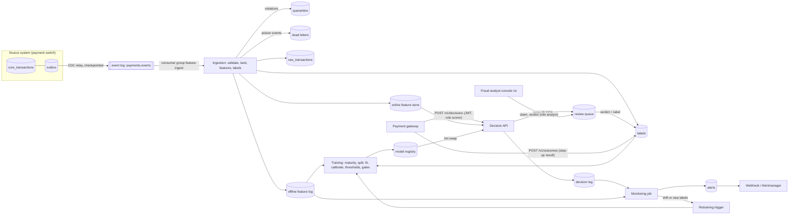

# Architecture

## The request path

1. The gateway sends the authorisation request with a bearer token. The body is checked against the same contract as the
   event stream; a non-conforming request is rejected before any work is done.
2. The idempotency key (the header, or the transaction id) is looked up. A retry returns the stored decision.
3. Features are computed by `features/transforms.compute` from the card, device and merchant states in the online store.
   The states describe everything up to, and not including, this request.
4. The production model scores the vector and its packaged thresholds give the action. If there is no model, the model was
   refused, the feature fetch used the whole deadline, or scoring raised, the rules fallback answers and the decision is
   flagged `fallback: true`. The rules can add friction (STEP_UP) and never decline.
5. The decision, its features and its latency are written to the decision log. A BLOCK also creates a review task.
6. When the switch commits the transaction, its outbox row reaches the ingestion consumer through CDC, the feature states
   are updated and the feature vector is logged for training.

## Design decisions

| Decision | Why | What would change it |
|---|---|---|
| Transactional outbox for CDC | An event exists if and only if the business change committed; no dual-write gap | A source you cannot change: use log-based CDC (Debezium) on its tables |
| Transactions and chargebacks on one ordered topic | The merchant chargeback rate is point-in-time correct only if events are applied in order | Per-entity partitioning with event-time watermarks once volume needs parallel consumers |
| One feature implementation, features logged at processing time | Removes training/serving skew and leakage by construction | A feature that needs data unavailable at processing time: add a backfill job and a parity test for it |
| Labels only for matured transactions, both classes | Avoids teaching the model that recent fraud is genuine, and avoids a positives-only recent slice | A faster ground-truth signal (confirmed disputes within hours) |
| Thresholds packaged with the model | A version is a complete decision function; no classifier can run with another's thresholds | Thresholds that must change intraday: move them to config with their own audit trail |
| Algorithm chosen on validation, gates on test | The test window stays an honest estimate | More candidates: add cross-validation over several chronological folds |
| Every block reviewed by a person | A wrongly declined customer is the expensive error | Volume beyond analyst capacity: review a risk-weighted sample and measure the rest by chargeback |
| Rules fallback never blocks | Failing open with friction is safer for the customer than failing closed on a broken model | A regulator or scheme rule that requires fail-closed above an amount |

## What is real and what you replace

| Concern | In this repository | In production |
|---|---|---|
| Source system | `data/source_system.py` simulates the switch | Your switch. Keep the outbox contract; delete the simulator |
| CDC | A poller over the outbox table | Debezium (or your platform's CDC) tailing the same outbox |
| Event log | A PostgreSQL / SQLite table with offsets and a DLQ (`src/bsref/bus.py`) | Kafka, Kinesis or Pub/Sub. The handler contract (idempotent, ordered per key) is unchanged |
| Online feature store | A table (`online_features`) | Redis / DynamoDB / Aerospike behind the same `get` / `put` |
| Offline feature store | A table (`txn_features`) | A warehouse or lake table partitioned by event date |
| Model registry | Files under `models/registry` | MLflow, SageMaker or Vertex AI registry with the same four operations |
| Identity | Local token issuer with users from `configs/users.yaml` | `AUTH_MODE=oidc` and your identity provider; the role checks do not change |
| Scheduling | `make` targets; Kubernetes CronJobs | Your orchestrator (Airflow, Argo, Dagster) calling the same modules |
| Scale | One API process handles the demo | The API is stateless: scale it horizontally; partition ingestion by card |

Not implemented here, and required before real traffic: load testing against your latency SLO, secret management, network
controls and encryption for your environment, a fairness review of the features for your population, PCI DSS scoping (this
code handles tokens, never card numbers), disaster recovery, and shadow / canary rollout of each new model.

## Adapting it

To build another real-time decisioning use case on this skeleton, change, in order: the event contract
(`data/contracts/`), the tables in `data/schema.py`, the entity states and features (`features/`), the label and its
maturity rule (`training/dataset.py`), the decision vocabulary and policy (`serving/model.py`, `configs/pipeline.yaml`), and
the review screen (`api/ui/`). The platform layer (`src/bsref`), the registry, the gates, the monitoring job and the
infrastructure stay as they are.
